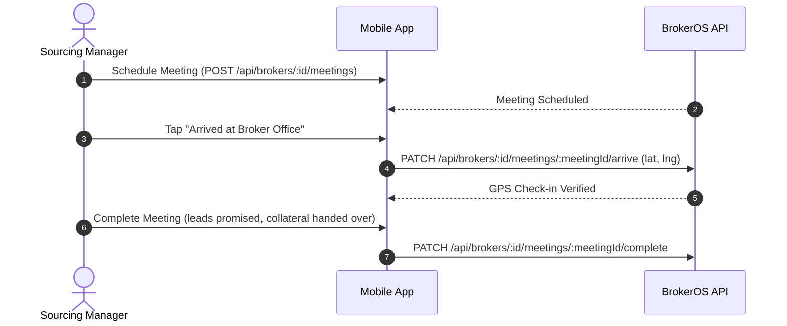

The Brokers API powers the **Channel Partner (CP)** line of business in BrokerOS. External brokers are real estate agents who introduce prospective buyers. Sourcing Managers (SM) cultivate broker relationships, conduct meetings, and manage deal pipelines, while Closing Managers (CM) convert referred leads on site.

```http
BASE URL: /api/brokers
```

---

## Endpoints Summary

| Method | Path | Description | Access |
| :-- | :-- | :-- | :-- |
| `GET` | `/api/brokers` | List brokers filtered by project or follow-up date | Sourcing Team |
| `POST` | `/api/brokers` | Onboard a new broker or real estate agency | Sourcing Team |
| `GET` | `/api/brokers/:id` | Get broker profile, tier, KYC, and activity history | Sourcing Team |
| `PATCH` | `/api/brokers/:id` | Update broker contact, agency, or RERA details | Sourcing Team |
| `POST` | `/api/brokers/:id/deal` | Update active deal card or pipeline stage | Sourcing Team |
| `POST` | `/api/brokers/:id/notes` | Log a quick interaction note | Sourcing Team |
| `POST` | `/api/brokers/:id/follow-ups` | Schedule a follow-up reminder with the broker | Sourcing Team |
| `PATCH` | `/api/brokers/:id/follow-ups/:followUpId/confirm` | Mark a broker follow-up as confirmed | Sourcing Team |
| `POST` | `/api/brokers/:id/meetings` | Schedule an in-person or office meeting | Sourcing Team |
| `PATCH` | `/api/brokers/:id/meetings/:meetingId/arrive` | GPS check-in at broker's agency office | Sourcing Team |
| `PATCH` | `/api/brokers/:id/meetings/:meetingId/complete` | Complete meeting and log commitments/leads promised | Sourcing Team |
| `POST` | `/api/brokers/:id/ai-transition-note` | Generate AI summary for handoff to another manager | Sourcing Team |
| `GET` | `/api/brokers/sourcing-managers` | List all active Sourcing Managers | Authenticated |
| `GET` | `/api/brokers/commissions/all` | List brokerage commission records and claims | Sourcing / Finance |
| `POST` | `/api/brokers/commissions/:recordId/complete` | Settle commission with payment receipt upload | Finance / Admin |

---

## List Brokers

```http
GET /api/brokers
```

### Query Parameters

| Parameter | Type | Required | Description |
| :-- | :-- | :-- | :-- |
| `projectId` | `string` | No | Filter brokers active in a specific CP project |
| `followUpDate` | `string` | No | ISO date (`YYYY-MM-DD`) for follow-ups due today |

### Response Example

```json
[
  {
    "id": "cm123brk001",
    "name": "Suresh Gupta",
    "agencyName": "Apex Realty Solutions",
    "phone": "+919876500001",
    "email": "suresh@apexrealty.in",
    "reraNumber": "A51900012345",
    "tier": "GOLD",
    "totalBookings": 14,
    "totalCommissionEarned": 2850000,
    "assignedSourcingManagerId": "cm123user_sm1",
    "status": "ACTIVE"
  }
]
```

---

## Create Broker

```http
POST /api/brokers
```

### Request Body

| Field | Type | Required | Description |
| :-- | :-- | :-- | :-- |
| `name` | `string` | **Yes** | Broker contact name |
| `phone` | `string` | **Yes** | Primary phone number |
| `agencyName` | `string` | No | Real estate brokerage firm or agency name |
| `email` | `string` | No | Business email |
| `reraNumber` | `string` | No | State RERA individual or firm registration number |
| `tier` | `string` | No | `PLATINUM`, `GOLD`, `SILVER`, `BRONZE` |
| `address` | `string` | No | Broker office address |
| `latitude` | `number` | No | Broker office latitude (for meeting verification) |
| `longitude` | `number` | No | Broker office longitude (for meeting verification) |

---

## Schedule Broker Meeting & GPS Arrival

Field sourcing managers visit broker offices to pitch CP schemes, deliver marketing collateral, and collect client referrals.



### Arrive at Meeting Request

```http
PATCH /api/brokers/:id/meetings/:meetingId/arrive
```

```json
{
  "latitude": 12.9352,
  "longitude": 77.6245
}
```

---

## AI Transition Note

```http
POST /api/brokers/:id/ai-transition-note
```

When a Sourcing Manager changes territory or leaves the firm, BrokerOS uses Groq LLM to synthesize all past meetings, calls, notes, and broker idiosyncrasies into an executive onboarding summary for the incoming manager.

### Response Example

```json
{
  "brokerId": "cm123brk001",
  "summary": "Suresh Gupta runs Apex Realty with 12 sub-agents in HSR Layout. Historically strong in 3BHK sales. Prefers fortnightly commission disbursement and expects WhatsApp project updates over email. Highly motivated by international trip incentive contests.",
  "relationshipHealth": "STRONG",
  "keyRecommendations": [
    "Invite to upcoming CP meet at project launch",
    "Follow up on 3 pending clients visiting Tower B this weekend"
  ],
  "generatedAt": "2026-10-01T08:15:00.000Z"
}
```

---

## Settle Broker Commission

```http
POST /api/brokers/commissions/:recordId/complete
Content-Type: multipart/form-data
```

Once post-sales verifies client token and agreement completion, Finance uploads the bank payment advice slip and marks the commission settled.

### Form Fields

- `file`: PDF or image bank transfer receipt
- Session user ID automatically logged for financial audit compliance
