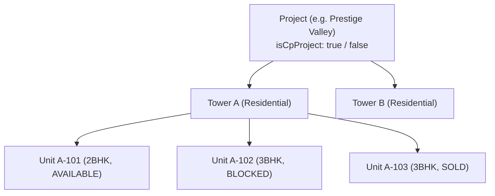

The Inventory API structures your property catalogue in a three-tier hierarchy: **Projects → Towers / Phases → Units**. It controls live unit availability status (preventing double-bookings) and scopes sales and sourcing team access.

```http
BASE URL: /api/inventory
```

---

## Endpoints Summary

| Method | Path | Description | Access |
| :-- | :-- | :-- | :-- |
| `GET` | `/api/inventory/projects` | List projects with filtering | Authenticated |
| `POST` | `/api/inventory/projects` | Create a new real estate project | Authenticated |
| `GET` | `/api/inventory/projects/:projectId/towers` | List towers and floors within a project | Authenticated |
| `GET` | `/api/inventory/projects/:projectId/assignments` | View team members assigned to a project | Authenticated |
| `POST` | `/api/inventory/projects/:projectId/assign` | Assign sourcing, closing, or sales staff | Authenticated |
| `GET` | `/api/inventory/projects/towers/:towerId/assignments` | View staff assigned to a specific tower | Authenticated |
| `POST` | `/api/inventory/projects/towers/:towerId/assign` | Assign staff to a tower | Authenticated |
| `PATCH` | `/api/inventory/units/:unitId/status` | Update unit status (`AVAILABLE`, `BLOCKED`, `SOLD`) | Authenticated |
| `GET` | `/api/inventory/units/:unitId/booking` | Retrieve active booking linked to a unit | Authenticated |
| `PATCH` | `/api/inventory/projects/:projectId/possession` | Update possession date for an entire project | Authenticated |
| `PATCH` | `/api/inventory/towers/:towerId/possession` | Update possession date for a tower | Authenticated |
| `PATCH` | `/api/inventory/units/:unitId/possession` | Update possession date for a single unit | Authenticated |

---

## Project Hierarchy



---

## List Projects

```http
GET /api/inventory/projects
```

Returns projects accessible to the authenticated user. Results automatically respect user assignments and the `isCpProject` flag.

### Query Parameters

| Parameter | Type | Required | Description |
| :-- | :-- | :-- | :-- |
| `isCpProject` | `boolean` | No | When `true`, filters external CP projects; `false` filters internal projects |
| `status` | `string` | No | `PLANNING`, `UNDER_CONSTRUCTION`, `READY_TO_MOVE`, `COMPLETED` |
| `search` | `string` | No | Search by project name, locality, or city |

### Response Example

```json
[
  {
    "id": "cm123proj001",
    "name": "Emerald Heights",
    "slug": "emerald-heights",
    "city": "Bengaluru",
    "locality": "Whitefield",
    "isCpProject": false,
    "reraNumber": "PRM/KA/RERA/1251/446/PR/200123/003456",
    "latitude": 12.9698,
    "longitude": 77.7499,
    "totalUnits": 240,
    "availableUnits": 48,
    "possessionDate": "2027-06-30T00:00:00.000Z"
  }
]
```

---

## Create Project

```http
POST /api/inventory/projects
```

### Request Body

| Field | Type | Required | Description |
| :-- | :-- | :-- | :-- |
| `name` | `string` | **Yes** | Project marketing name |
| `city` | `string` | **Yes** | City location |
| `locality` | `string` | No | Specific locality or neighborhood |
| `isCpProject` | `boolean` | No | Sets Channel Partner vs Internal boundary (defaults to `false`) |
| `reraNumber` | `string` | No | State RERA registration number |
| `latitude` | `number` | No | GPS latitude for site visit verification |
| `longitude` | `number` | No | GPS longitude for site visit verification |

---

## Assign Team to Project or Tower

```http
POST /api/inventory/projects/:projectId/assign
```

```http
POST /api/inventory/projects/towers/:towerId/assign
```

Scoping team members ensures users only see inventory, leads, and broker activities relevant to their assigned projects.

### Request Body

```json
{
  "sourcingManagerIds": ["cm123user_sm1", "cm123user_sm2"],
  "closingManagerIds": ["cm123user_cm1"],
  "salesExecIds": ["cm123user_se1", "cm123user_se2", "cm123user_se3"]
}
```

---

## Update Unit Status

```http
PATCH /api/inventory/units/:unitId/status
```

Modifies availability status on the inventory matrix. If an executive blocks a unit during a hot negotiation, it cannot be reserved by another agent.

### Request Body

| Field | Type | Required | Description |
| :-- | :-- | :-- | :-- |
| `status` | `string` | **Yes** | `AVAILABLE`, `BLOCKED`, `BOOKED`, `SOLD` |
| `blockedReason` | `string` | No | Required if status is `BLOCKED` (e.g. `Client token cheque under clearing`) |
| `blockedUntil` | `string` | No | ISO timestamp when the hold automatically expires |

### Request Example

```json
{
  "status": "BLOCKED",
  "blockedReason": "Cheque clearance in progress for token amount ₹2,00,000",
  "blockedUntil": "2026-10-04T18:00:00.000Z"
}
```

---

## Update Possession Dates

Possession dates can be rolled out hierarchically at the project level, tower level, or for a single customized unit.

```http
PATCH /api/inventory/projects/:projectId/possession
PATCH /api/inventory/towers/:towerId/possession
PATCH /api/inventory/units/:unitId/possession
```

### Request Body

```json
{
  "possessionDate": "2027-12-31T00:00:00.000Z",
  "notes": "Delay of 2 months due to municipal water line clearance"
}
```
