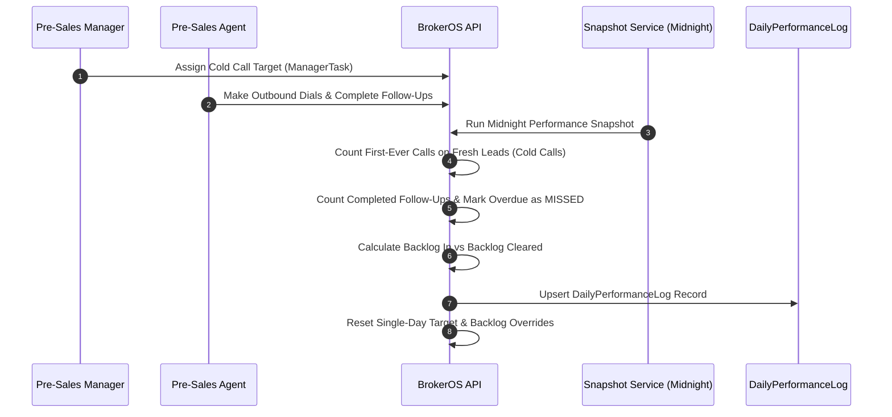

Pre-sales floor productivity relies on structured daily routines and clear activity targets. In BrokerOS, Pre-Sales Managers define daily targets for their team, while the system automatically tracks verified cold calls, completed follow-ups, and backlog rollovers without manual reporting.

---

## Manager Task Targets (`ManagerTask`)

Pre-Sales Managers create active tasks that set daily cold calling quotas for telecalling executives:

- **Target Quota**: Sets the daily cold call goal per executive (system default is 100 calls).
- **Team Assignment**: Managers can assign a task to individual agents or broadcast it across all active subordinates (`assignToAll`).
- **Single Active Task Rule**: Each pre-sales executive can have only one active task assignment at a time.
- **Manager Overrides**: Managers can customize a specific agent's requirements for the day using `targetOverride` (custom call target) or `backlogOverride` (manually reducing an accumulated calling backlog).

---

## Daily Snapshot Workflow (`SnapshotService`)

Every night at midnight, the background `SnapshotService` compiles verified activity across telephony logs and follow-up records into a permanent daily snapshot:

---

## Daily Performance Snapshot (`DailyPerformanceLog`)

The midnight snapshot evaluates the day's work using concrete business rules:

1. **Cold Calls Done**: Counts verified outbound calls where the lead was in `NEW` or `CONTACTED` status and this was the agent's first-ever call to that lead. Subsequent calls to the same lead count as follow-up activity.
2. **Follow-Ups Done**: Counts all follow-ups completed during the day.
3. **Missed Follow-Ups**: Any follow-up scheduled for the day that remains in `SCHEDULED` or `RESCHEDULED` status at midnight is automatically marked `MISSED`, and its ID is archived in `missedFollowUpIds`.
4. **Backlog Calculation**: Unmet daily call targets rollover into `coldCallBacklogIn`. When an agent exceeds their daily target, surplus calls are credited toward clearing accumulated backlog (`coldCallBacklogCleared`).

---

## Monthly Pre-Sales Leaderboard

The Pre-Sales Leaderboard evaluates cumulative team performance across the calendar month. Rankings are calculated dynamically using a weighted scoring formula:

| Metric | Weight | Description |
| :-- | :-- | :-- |
| **Cold Calls** | 25% | Total verified first-time calls completed during the month. |
| **Follow-Ups** | 25% | Total scheduled follow-up tasks successfully completed. |
| **Site Visits** | 50% | Total completed site visits generated by the pre-sales agent. |
