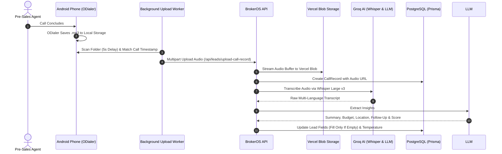

BrokerOS eliminates manual call logging by combining native Android call recording capture with Groq AI transcription. Every customer conversation is transcribed, summarized, and analyzed for key buying signals within seconds of hangup.

---

## Architecture Flow

---

## Native ODialer Capture (Android)

BrokerOS integrates with native Android recording directories (including ColorOS / OxygenOS ODialer):

- **State Detection**: The mobile app's `CallBroadcastReceiver` monitors phone state changes (`OFFHOOK` to `IDLE`) to record exact start and end timestamps.
- **Grace Period Buffer**: When a call ends, a background worker triggers with a 5-second delay to allow ODialer to complete writing the `.mp3` file to storage.
- **Time Window Matching**: The worker scans the designated recording folder using Android `DocumentFile` and selects the audio file modified during that call window.
- **Background Upload**: The file is streamed via multipart HTTP request directly to the BrokerOS API with the agent's authentication token.

---

## Secure Cloud Storage & Playback

Audio files are streamed directly to **Vercel Blob Storage**:

- **Naming Convention**: Stored hierarchically under `calls/:targetId-:timestamp-:filename`.
- **Private Audio Streaming**: Managers and agents can listen to recordings directly from the CRM timeline via the protected proxy endpoint `/api/leads/call-records/:id/audio`.
- **Zero Local Retention**: Audio files can be pruned from mobile local storage after successful upload to protect client confidentiality.

---

## AI Processing & Insights

BrokerOS uses **LPU inference engine** for ultra fast transcription and structured field extraction:

### Speech to Text

The audio file is transcribed using Groq's Whisper Large v3 model. The system provides contextual prompt hints to accurately parse multi-language conversations, real estate terminology, and mixed dialect speech.

### Structured Extraction

The raw transcript is processed through an LLM to extract actionable real estate fields:

| Field | Description | CRM Behavior |
| :-- | :-- | :-- |
| **Summary** | 2 to 3 sentence concise interaction overview | Saved as the primary summary note on the call record. |
| **Next Step Suggestion** | Single actionable recommendation for the agent | Populates `lead.aiNextStepSuggestion`. |
| **Extracted Budget** | Detected numeric budget figure | Populates `lead.budget` (Fill Only If Empty). |
| **Project Interest** | Matches mentioned project name against active database inventory | Populates `lead.interestedProjectId` (Fill Only If Empty). |
| **Location & Requirements** | Buyer location preference and unit specifications | Populates `preferredLocation` and `requirements` (Fill Only If Empty). |
| **Automated Follow-Up** | Calculates callback date based on lead preference or 1 to 3 days out | Schedules a follow-up between 10:00 AM and 6:00 PM (never on Sunday). |

<Note>
  **Fill Only If Empty Rule**: The AI pipeline only updates lead fields (`budget`, `interestedProjectId`, `preferredLocation`, `requirements`) if the existing database field is blank. It never overwrites information manually entered by human sales agents.
</Note>
