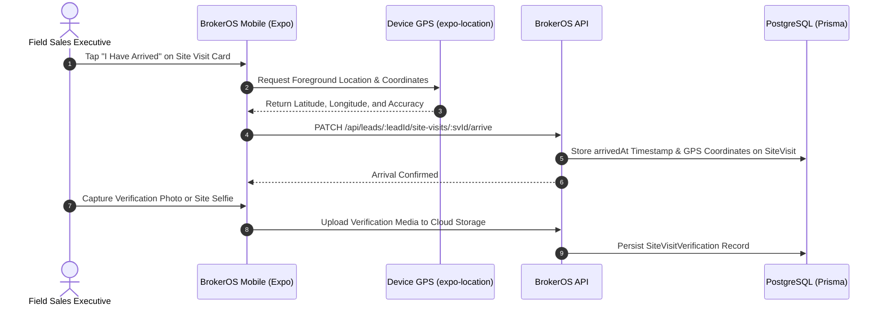

A major operational challenge for real estate brokerages is proxy or unverified site visit logging, where agents might record visits without physically meeting the buyer on site. BrokerOS solves this using native mobile GPS arrival logging, media verification, and permanent database audit records.

---

## The Verification Flow

---

## Native Mobile GPS Arrival

When a sales executive arrives at the project site or sales gallery:

- **Location Permissions**: The mobile app requests high-accuracy foreground location access using `expo-location`.
- **Coordinate Capture**: Upon tapping "I Have Arrived", the app captures device latitude, longitude, and horizontal accuracy.
- **Immediate Arrival Logging**: The API logs `arrivedAt`, `arriveLatitude`, and `arriveLongitude` directly on the `SiteVisit` record.
- **Timestamp Integrity**: The check-in timestamp is set by the server upon receipt, preventing manual device clock manipulation.

---

Key verification elements stored include:

- **Executive Site Selfie (`siteVisitSelfieUrl`)**: An on-site photo taken by the executive at the project gallery or entrance.
- **Customer Selfie (`customerSelfieUrl`)**: An optional photo taken with the visiting client confirming personal attendance.
- **Additional Photos (`additionalPhotoUrls`)**: Supporting photos showing the physical unit walkthrough or amenity presentation.
- **Location Accuracy (`locationAccuracy`)**: Stored GPS horizontal accuracy metric in meters.

---

## Manager Audit & Performance Validation

Site visit verification provides complete transparency for sales managers and leadership:

- **Audit Timeline**: Managers can inspect exact check-in timestamps, GPS coordinates, and uploaded verification photos directly from the lead activity feed.
- **Performance Scoring**: Pre-sales and sales leaderboard scores only count verified completed visits, ensuring activity metrics represent genuine customer walkthroughs.
- **Dispute Resolution**: If a dispute arises over client representation or broker sourcing credit, timestamped GPS coordinates and photos provide immutable evidence of which agent conducted the presentation.
