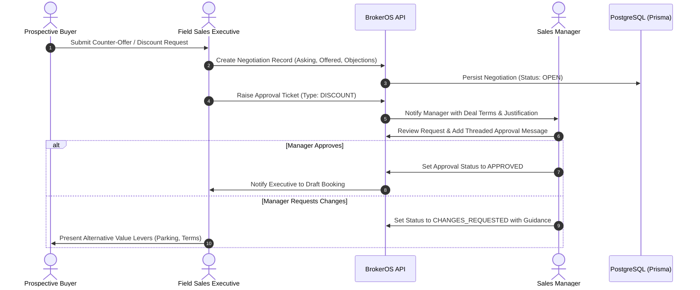

Real estate purchases frequently involve commercial negotiations. In luxury and enterprise property sales, closing a deal often comes down to structuring value incentives and obtaining manager authorization within controlled margins.

---

## The Negotiation Workflow

---

## Commercial Closing Levers

When a buyer requests pricing concessions, sales executives are encouraged to utilize non-price value levers before discounting base property rates:

<CardGroup cols={2}>
  <Card title="Floor Rise Adjustments" icon="layer-group">
    Adjusting or waiving floor elevation premiums for upper-level units to meet client budget constraints.
  </Card>

  <Card title="Parking & Storage Upgrades" icon="car">
    Offering a secondary parking space, premium garage stall location, or storage locker without a direct cash price reduction.
  </Card>

  <Card title="Amenity & Club Waivers" icon="spa">
    Absorbing one-time clubhouse registration, administrative fees, or legal documentation expenses.
  </Card>

  <Card title="Flexible Payment Milestones" icon="calendar-days">
    Tailoring construction-linked milestone schedules or deferred deposit timelines to accommodate buyer cash flow.
  </Card>
</CardGroup>

---

## The Negotiation Record (`Negotiation`)

BrokerOS provides a dedicated negotiations API (`/api/leads/:leadId/negotiations`) to track every offer round:

| Field | Type | Description |
| :-- | :-- | :-- |
| **askingPrice** | Decimal | Original inventory listed price for the selected unit. |
| **offeredPrice** | Decimal | Client's proposed purchase price. |
| **counterPrice** | Decimal | Brokerage proposed counter-offer. |
| **finalPrice** | Decimal | Agreed closing price upon successful negotiation. |
| **discountRequested** | Decimal | Total price reduction requested by the buyer. |
| **status** | NegotiationStatus | Current state: `OPEN`, `COUNTER_OFFERED`, `MANAGER_REVIEW`, `APPROVED`, `REJECTED`, `CLOSED`. |
| **customerObjections** | Text | Specific pricing or market objections cited by the customer. |
| **managerSuggestion** | Text | Strategic negotiation advice or counter-tactics provided by leadership. |
| **negotiationNotes** | Text | Summary title and narrative of the discussion round. |
| **nextActionPlan** | Text | Concrete next steps agreed upon between the buyer and executive. |

---

## Ticket-Based Approval System (`ApprovalRequest`)

When a proposed price adjustment requires managerial authorization, sales executives submit a formal approval ticket:

- **Targeted Assignment**: The request is routed directly to the sales executive's assigned manager (`managerId`).
- **Threaded Communication (`ApprovalMessage`)**: Managers and executives collaborate through an in-app messaging thread attached to the ticket, enabling discussions, counter-strategies, and document attachments.
- **Audit Tracking**: The system maintains an unalterable history of who requested the concession, the justification provided, and the manager's formal approval timestamp.
- **Integration with Bookings**: Once approved, the final agreed price and discount are linked directly to the confirmed `Booking` record.
