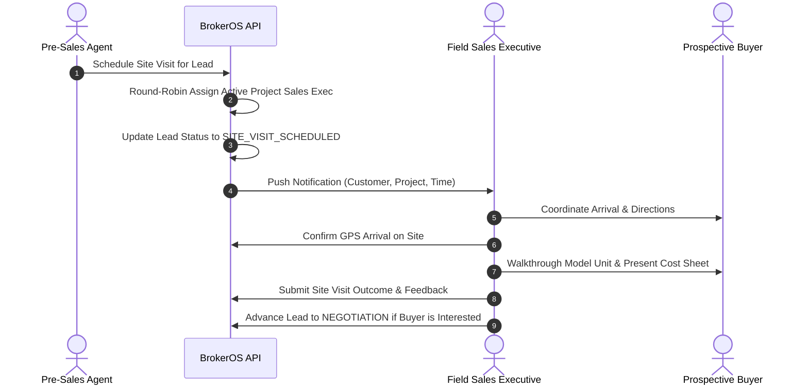

In real estate, site visits are the defining milestone of the sales cycle. Confirmed property bookings typically occur following a physical walkthrough of the project site, model units, and sales gallery.

---

## The Site Visit Workflow

---

## Site Visit Assignment & Pre-Visit Briefing

### Automated Project Round-Robin

When pre-sales schedules a visit for a specific project:

- BrokerOS queries active sales executives mapped to that project (`ProjectAssignment`).
- The system assigns the visit using deterministic round-robin rotation based on the previous assignment.
- The lead's `assignedUserId` automatically transfers to the designated field sales executive.
- An instant push notification alerts the executive with customer details, project name, and scheduled time slot.

### Pre-Visit Briefing

Before greeting the client at the project lounge, the sales executive reviews the lead profile in the mobile app:

- AI call transcription summaries and next-step recommendations from the pre-sales discovery calls.
- Specific preferences such as configuration, desired floor level, and orientation.
- Verified budget range and timeline.

---

## Conducting the Walkthrough

During the on-site presentation, the sales executive guides the buyer through key presentation stages:

- **Master Plan & Amenities**: Reviewing overall community layouts, tower placements, clubhouse facilities, and green spaces.
- **Model Units**: Walking through actual floor plans, room dimensions, natural lighting, and interior specifications.
- **Inventory Matrix & Cost Presentation**: Using the real-time BrokerOS inventory screen to check unit availability and present transparent pricing breakdowns.

---

## Logging Site Visit Outcomes

Immediately following the visit, the sales executive logs the structured visit feedback in the mobile app:

| Feedback Field | Allowed Values / Format | Description |
| :-- | :-- | :-- |
| **Status** | `ASSIGNED`, `SCHEDULED`, `CONFIRMED`, `IN_PROGRESS`, `COMPLETED`, `CANCELLED`, `RESCHEDULED`, `NO_SHOW` | Current operational state of the visit. |
| **Interest Level** | `HIGH`, `MEDIUM`, `LOW`, `NOT_INTERESTED` | Evaluates buyer engagement and purchase intent. |
| **Confirmed Budget** | Number (e.g. `1250000`) | Validated financial capability after reviewing pricing. |
| **Unit Preference** | String (e.g. `Unit 1402, 3-Bedroom`) | Specific inventory configuration preferred by the buyer. |
| **Customer Reaction** | String | Qualitative sentiment regarding the development and amenities. |
| **Customer Objections** | Text | Specific concerns such as pricing, completion dates, or layout. |
| **Closing Probability** | String (e.g. `80%`) | Estimated likelihood of moving to booking. |
| **Next Action** | String | Concrete follow-up deliverable for the sales executive. |

---

## Pipeline Advancement

Completing a site visit triggers automatic activity tracking:

- **Daily Task Completion**: Marking a site visit `COMPLETED` automatically verifies the executive's daily site visit performance targets.
- **Advancing to Negotiation**: If the buyer expresses strong purchase intent, the sales executive advances the lead status to `NEGOTIATION` and opens a formal negotiation thread in BrokerOS.
- **Rescheduling & Cancellations**: If a client misses an appointment, the visit is flagged as `NO_SHOW` or `RESCHEDULED`, preserving full historical audit logs on the lead timeline.
