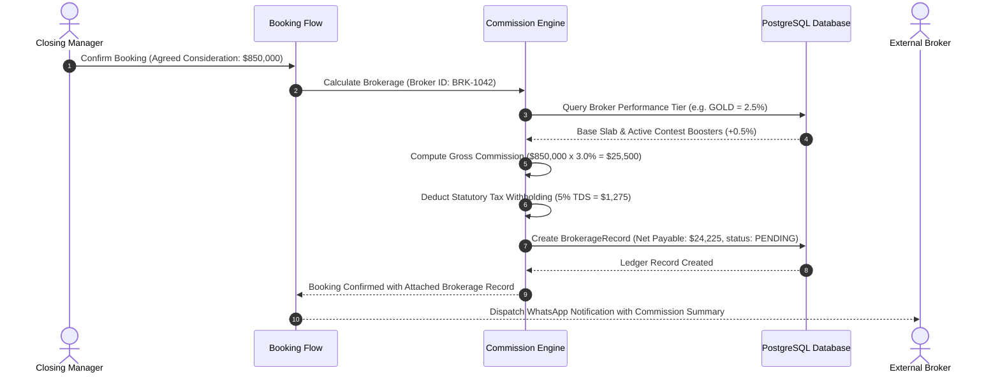

When a Channel Partner booking is confirmed, BrokerOS automatically calculates the broker's commission and creates a **`BrokerageRecord`**. This ensures financial transparency, eliminates manual spreadsheet calculation errors, and establishes an immutable accounting trail.

---

## Commission Calculation Flow

BrokerOS computes gross commission consideration, applies applicable tax withholdings, and instantiates the ledger record upon booking confirmation:

---

## The Brokerage Record Entity

Brokerage records track the commercial consideration and audit milestones for each confirmed transaction:

| Field Attribute | Type | Description |
| :-- | :-- | :-- |
| **`bookingId`** | Reference | Linked confirmation record for the sold unit. |
| **`brokerId`** | Reference | Referring external broker or agency. |
| **`bookingValue`** | Decimal | Total agreed contract consideration for the property. |
| **`brokeragePercent`** | Decimal | Contracted commission rate (for example, 2.5%). |
| **`brokerageAmount`** | Decimal | Gross commission consideration prior to statutory deductions. |
| **`tdsDeducted`** | Decimal | Statutory tax deduction withheld at source. |
| **`netPayable`** | Decimal | Net liquid disbursement amount payable to the partner. |
| **`status`** | Enum | Accounting lifecycle stage (`PENDING`, `APPROVED`, `PAID`, `DISPUTED`, `HELD`). |
| **`paymentReference`** | String | Bank UTR, wire reference, or Vercel Blob payment advice receipt URL. |
| **`approvedById`** | Reference | User ID of the Finance Manager authorizing the payout. |

---

## Lifecycle Stages of a Brokerage Record

Every brokerage record progresses through standardized verification stages before funds are released:

| Status | Stage Meaning | Prerequisite for Advancement |
| :-- | :-- | :-- |
| **`PENDING`** | Deal confirmed, but customer has not yet completed agreement execution. | Buyer must pay initial 10% deposit and sign the formal agreement. |
| **`APPROVED`** | Milestone verified and broker tax invoice approved by Finance. | Finance Manager signs off on the disbursement batch. |
| **`PAID`** | Bank wire transfer completed and payment advice slip attached. | Final terminal state. Broker notified with wire confirmation. |
| **`DISPUTED`** | Attribution or commission percentage flagged for manual review. | Director or Channel Partner Head resolves commercial dispute. |
| **`HELD`** | Administrative freeze applied due to compliance or KYC gaps. | Resolution of outstanding tax documents or buyer payment queries. |

---

## Split Commission Support

On complex sales involving cross-functional teamwork, BrokerOS supports fractional commission splitting:

- **External Broker**: 70% of total commission allocation.
- **Sourcing Manager Incentive**: 15% internal performance bonus.
- **Closing Manager Incentive**: 15% internal performance bonus.

All fractional shares are computed concurrently upon booking confirmation, providing transparent visibility across both external partner accounts and internal incentive payrolls.
