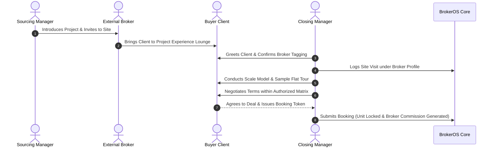

While Sourcing Managers operate in the field recruiting brokerages, **Closing Managers (CM)** are stationed permanently on-site at developer experience centres and project sales lounges. Their role is to receive the broker and their client, present the property, negotiate commercial terms, and close the sale.

---

## The Sourcing-to-Closing Handshake

Closing Managers execute the final conversion stage of the partner referral funnel:



---

## Core Responsibilities of a Closing Manager

### In-Lounge Reception and Client Registration

When an external broker arrives with a prospective buyer, the Closing Manager welcomes them in the sales lounge and immediately enters the buyer details into the BrokerOS walk-in module:

- Tags the referring **Broker ID**.
- Associates the assigned **Sourcing Manager ID**.
- Captures client preferences, budget range, and desired floor elevations.

### High-Impact Property Presentations

Closing Managers possess deep technical knowledge of structural layouts, architectural finishes, floor plan efficiencies, and municipal infrastructure:

- Leads the walk-through of the architectural model, amenities, and model units.
- Explains developer delivery milestones and statutory compliance credentials.

### Commercial Negotiation and Discount Slabs

Closing Managers hold authority to approve price discounts within authorized boundaries (typically up to 3.0% of base price):

- Addresses client queries regarding pricing, payment schedules, and unit specifications.
- If the customer requires terms exceeding standard slabs, the manager submits an expedited approval request via the [Approvals API](/api-reference/approvals).

---

## Preventing Broker Attribution Disputes

A frequent point of friction in high-velocity real estate sales is **Broker Poaching** or attribution disputes, where competing brokers claim credit for the same prospective buyer:

```text
BrokerOS Rule: First Walk-In Priority Lock
```

- When a client enters a project lounge with Broker A, their phone number is cryptographically tagged to Broker A for a default window of **60 days**.
- If Broker B brings the same customer three weeks later, the system detects the active attribution and alerts the Closing Manager:
  ```json
  {
    "warning": "Client phone number is actively registered under Apex Realty (Broker ID: BRK-1042) until 2026-11-20. Commission credit cannot be transferred without written Director authorization."
  }
  ```
- This transparent rule guarantees fair attribution and preserves trust across the external partner network.
