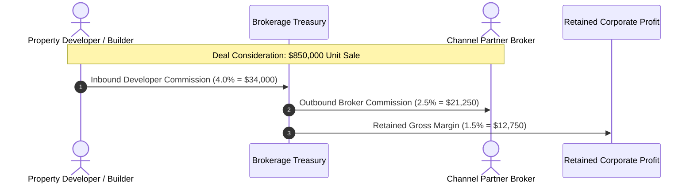

In the enterprise real estate brokerage ecosystem, revenue flows from the property developer to the brokerage firm before downstream payouts are disbursed to external Channel Partner brokers. BrokerOS tracks these master developer receivables using the **`InboundCommission`** model.

---

## Two-Way Commercial Margin

BrokerOS tracks the spread between gross developer revenue and external partner disbursements:

---

## Inbound Commission Milestones

Property developers typically release their commission commitments in staged disbursements tied to construction and legal milestones:

| Inbound Tranche | Percentage | Trigger Milestone |
| :-- | :-- | :-- |
| **Tranche 1 (Agreement Execution)** | 50% of Inbound Fee | Buyer completes the initial 10% payment deposit and executes the formal Agreement for Sale. |
| **Tranche 2 (Structural Milestone)** | 50% of Inbound Fee | Completion of the basement foundation raft or casting of the first residential floor superstructure slab. |

---

## Corporate Invoicing to Developers

When an eligible milestone is cleared, BrokerOS compiles confirmed units into a formal **Corporate B2B Tax Invoice** submitted directly to the developer accounts team:

### Invoice Components

- **Developer Corporate Entity**: Legal corporate name, corporate tax identifier, and registered project office address.
- **Brokerage Firm Credentials**: Master corporate banking details, electronic wire instructions, and company tax credentials.
- **Unit Schedule**: Comprehensive ledger of all booked units achieving the billing milestone within the cycle.
- **Itemized Calculation Example**:
  - Total Booked Property Consideration: \$3,400,000 (across 4 units)
  - Agreed Master Commission Rate: 4.0%
  - Total Fee Consideration: \$136,000
  - Milestone Disbursement (Tranche 1: 50%): \$68,000
  - Applicable Corporate Taxes / VAT: Itemized per jurisdiction
  - Net Billed Invoice Total: \$68,000 plus applicable taxes

---

## Accounts Receivable Aging and Reconciliation

The Finance workspace provides real-time visibility into developer receivables to protect corporate cash flow:

- **Current (0 to 30 Days)**: Recently generated invoices within standard commercial credit terms.
- **Overdue (31 to 60 Days)**: Flagged for executive escalation by the Commercial Director during monthly developer progress meetings.
- **Critical (60+ Days)**: Triggers an automated system alert advising Sourcing and Closing Managers to pause active priority pitching on the developer projects until outstanding receivables are reconciled.
