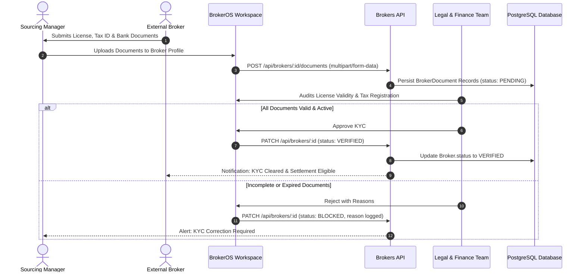

Under real estate statutory regulations and corporate accounting guidelines, brokerages cannot legally disburse commission settlements to unverified or unlicensed agents. BrokerOS enforces a strict KYC verification gate before any commercial payouts can be scheduled.

---

## KYC Verification Workflow

Every onboarding broker must submit compliance documentation, which is reviewed by the legal and finance teams before commission eligibility is unlocked:

---

## Mandatory KYC Document Checklist

BrokerOS requires four mandatory documents to transition a broker from `NEW` to `VERIFIED`:

### Real Estate License Certificate

- State real estate regulatory license number (for example, RERA agent certificate).
- The legal team verifies license validity against the official regulatory registry.
- Tracks expiration dates to ensure partners maintain active, compliant standing throughout transaction lifecycles.

### Tax Identification Document

- Permanent corporate or individual tax identification document (PAN, EIN, or national tax ID).
- Required for statutory tax deduction at source (TDS) and annual withholding tax certificates.

### Corporate Tax Registration

- State or federal sales/services tax registration certificate (for example, GSTIN).
- Validates the corporate entity name against tax records.
- Determines whether broker commission invoices include input tax credit considerations.

### Bank Account and Wire Details

- Scanned copy of a cancelled cheque, bank statement, or official wire instructions displaying:
  - Account Holder Legal Name (must match tax identification records).
  - Bank Account Number.
  - Bank Routing / Wire Identifier (IFSC code, routing transit number, or SWIFT code).
- Eliminates misdirected electronic disbursements and ensures fraud-free settlements.

---

## The Hard Payout Lock

BrokerOS enforces a strict database-level invariant:

<Warning>
  **No commission payout (`BrokerageSettlement`) can be marked `PAID` or `COMPLETED` if the broker KYC status is not `VERIFIED`**. Finance users attempting to disburse funds to unverified or blocked brokers receive an immediate validation error.
</Warning>

This safeguard guarantees that corporate disbursements comply with financial audit requirements and protects the firm from regulatory penalties.
