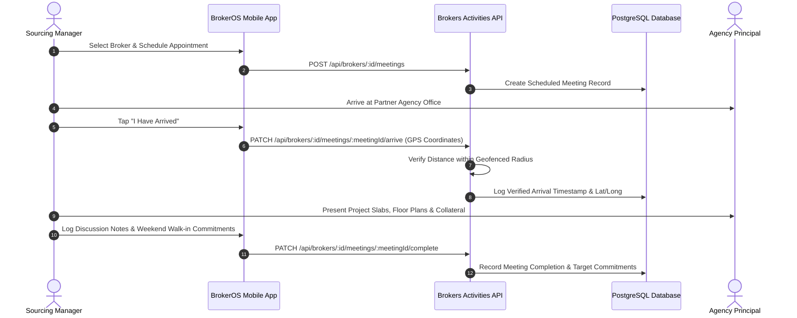

Sourcing Managers (SM) are the outbound relationship executives who drive the Channel Partner engine. Rather than selling directly to home buyers, Sourcing Managers cultivate relationships with external real estate brokerages, motivating them to bring their high-net-worth buyer clients to the firm's projects.

---

## Field Operations Workflow

Sourcing Managers spend the majority of their time in the field visiting brokerage offices, delivering physical marketing collateral, and securing client walk-in commitments for upcoming weekends:

---

## Field Meeting Verification

To ensure that Sourcing Managers actively visit partner broker offices across their designated territories, BrokerOS enforces GPS-verified meeting check-ins:

### Appointment Scheduling

Sourcing Managers schedule agency meetings via the mobile agenda:

- API endpoint: `POST /api/brokers/:id/meetings`
- Captures meeting agenda, planned discussion points, and targeted project focus.

### Geofenced Arrival Verification

Upon reaching the broker's registered office address, the manager taps **"I Have Arrived"** on their mobile device:

- API endpoint: `PATCH /api/brokers/:id/meetings/:meetingId/arrive`
- Transmits high-precision device coordinates (`latitude`, `longitude`).
- BrokerOS computes the Haversine distance between the device coordinates and the broker's registered agency address. If within the authorized threshold (typically 200 meters), the check-in is verified.

### Meeting Completion and Commitments

At the conclusion of the meeting, the manager logs the business outcomes:

- API endpoint: `PATCH /api/brokers/:id/meetings/:meetingId/complete`
- Discussion topics recorded: Launch preview dates, revised floor rise policies, festive brokerage schemes.
- Marketing materials delivered: High-res project brochures, floor cut-sheets, and digital link kits.
- **Walk-in Commitments**: The number of prospective buyers the broker promised to bring to the site sales lounge over the upcoming weekend.

---

## Sourcing Metrics and Performance KPIs

Sourcing Managers are evaluated on partner network activation, meeting cadence, and converted referral volume:

| KPI Metric | Benchmark Target | Operational Objective |
| :-- | :-- | :-- |
| **Field Broker Meetings** | 4 to 6 meetings per day | Maintains active presence and high agency touchpoints across territories. |
| **Active Transacting Brokers** | 15 to 20 agencies per month | Measures brokerages that have introduced at least one active buyer visit. |
| **Referred Site Visits** | 20 to 30 visits per month | Total buyer clients brought to project sales lounges by the partner network. |
| **Converted CP Bookings** | 4 to 8 bookings per month | Confirmed sales transactions attributed to the manager's broker network. |
