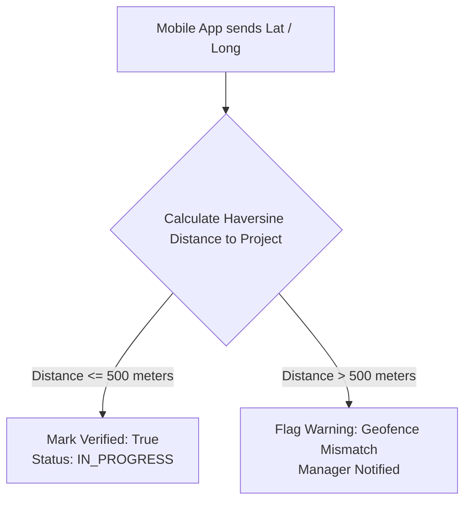

Site visits represent the highest-conversion stage in the real estate sales funnel. BrokerOS tracks scheduled visits, records detailed client feedback, and uses GPS coordinates to verify physical attendance at project locations.

```http
BASE URL: /api/leads
```

---

## Endpoints Summary

| Method | Path | Description | Access |
| :-- | :-- | :-- | :-- |
| `GET` | `/api/leads/:id/site-visits` | List all site visits scheduled for a lead | Authenticated |
| `POST` | `/api/leads/:id/site-visits` | Schedule a new site visit | Authenticated |
| `PATCH` | `/api/leads/site-visits/:siteVisitId` | Update visit details, interest level, and feedback | Authenticated |
| `DELETE` | `/api/leads/site-visits/:siteVisitId` | Delete or cancel a scheduled visit | Authenticated |
| `PATCH` | `/api/leads/:id/site-visits/:siteVisitId/arrive` | Record GPS check-in at the project location | Authenticated |

---

## List Lead Site Visits

```http
GET /api/leads/:id/site-visits
```

Returns the chronological list of all site visits scheduled or completed for the specified lead.

### Response Example

```json
[
  {
    "id": "cm123sv001",
    "leadId": "cm123lead001",
    "userId": "cm123user002",
    "projectId": "cm123proj001",
    "scheduledDate": "2026-10-04T10:30:00.000Z",
    "status": "SCHEDULED",
    "meetingNotes": "Customer requested visit to model apartment and clubhouse",
    "createdAt": "2026-09-29T11:00:00.000Z"
  }
]
```

---

## Schedule Site Visit

```http
POST /api/leads/:id/site-visits
```

Creates a new site visit task. When scheduled, the lead's status automatically transitions to `SITE_VISIT_SCHEDULED` and an entry is added to the executive's mobile calendar.

### Request Body

| Field | Type | Required | Description |
| :-- | :-- | :-- | :-- |
| `userId` | `string` | **Yes** | User ID of the sales executive conducting the visit |
| `projectId` | `string` | **Yes** | Project ID where the visit is taking place |
| `scheduledDate` | `string` | **Yes** | ISO 8601 date string (e.g. `2026-10-05T11:00:00Z`) |
| `meetingNotes` | `string` | No | Instructions, pickup location, or specific unit requests |
| `destinationUrl` | `string` | No | Google Maps direction link or site office pin |

### Request Example

```json
{
  "userId": "cm123user002",
  "projectId": "cm123proj001",
  "scheduledDate": "2026-10-05T11:00:00.000Z",
  "meetingNotes": "Client arriving with architect; focus on Tower B 3BHK layout."
}
```

---

## GPS Check-in (Arrive)

```http
PATCH /api/leads/:id/site-visits/:siteVisitId/arrive
```

Sales executives tap **"I Have Arrived"** on their BrokerOS mobile app when reaching the project site. The server checks the device's coordinates against the project's geofence.

### Request Body

| Field | Type | Required | Description |
| :-- | :-- | :-- | :-- |
| `latitude` | `number` | **Yes** | Device latitude from native GPS |
| `longitude` | `number` | **Yes** | Device longitude from native GPS |

### Verification Rule



<Tip>
  Projects must have valid `latitude` and `longitude` fields configured in the inventory database for geofence verification to succeed.
</Tip>

---

## Update Site Visit Outcome

```http
PATCH /api/leads/site-visits/:siteVisitId
```

After the visit is concluded, the executive submits complete qualitative and quantitative feedback.

### Request Body

| Field | Type | Required | Description |
| :-- | :-- | :-- | :-- |
| `status` | `string` | No | `SCHEDULED`, `COMPLETED`, `CANCELLED`, `RESCHEDULED`, `NO_SHOW` |
| `interestLevel` | `string` | No | `VERY_HIGH`, `HIGH`, `MEDIUM`, `LOW`, `NOT_INTERESTED` |
| `budgetConfirmed` | `number` | No | Verified budget confirmed during face-to-face discussion |
| `configInterest` | `string` | No | Configuration preferred (e.g. `3BHK-Luxury-East`) |
| `customerReaction` | `string` | No | Customer reaction to amenities, price, floor plan |
| `customerObjections` | `string` | No | Objections raised (e.g. possession date, price per sqft) |
| `closingProbability` | `string` | No | Estimated closing probability percentage (e.g. `80%`) |
| `nextAction` | `string` | No | Next step (e.g. `Send payment schedule by tonight`) |
| `completedAt` | `string` | No | ISO timestamp of visit conclusion |

### Request Example

```json
{
  "status": "COMPLETED",
  "interestLevel": "VERY_HIGH",
  "budgetConfirmed": 14000000,
  "configInterest": "3BHK Tower B Unit 1204",
  "customerReaction": "Loves the view and kitchen layout",
  "customerObjections": "Negotiating on car parking charges",
  "closingProbability": "85%",
  "nextAction": "Director approval requested for 2% parking waiver"
}
```

---

## Delete Site Visit

```http
DELETE /api/leads/site-visits/:siteVisitId
```

Removes a mistakenly scheduled visit or clears a cancelled visit from the calendar.
