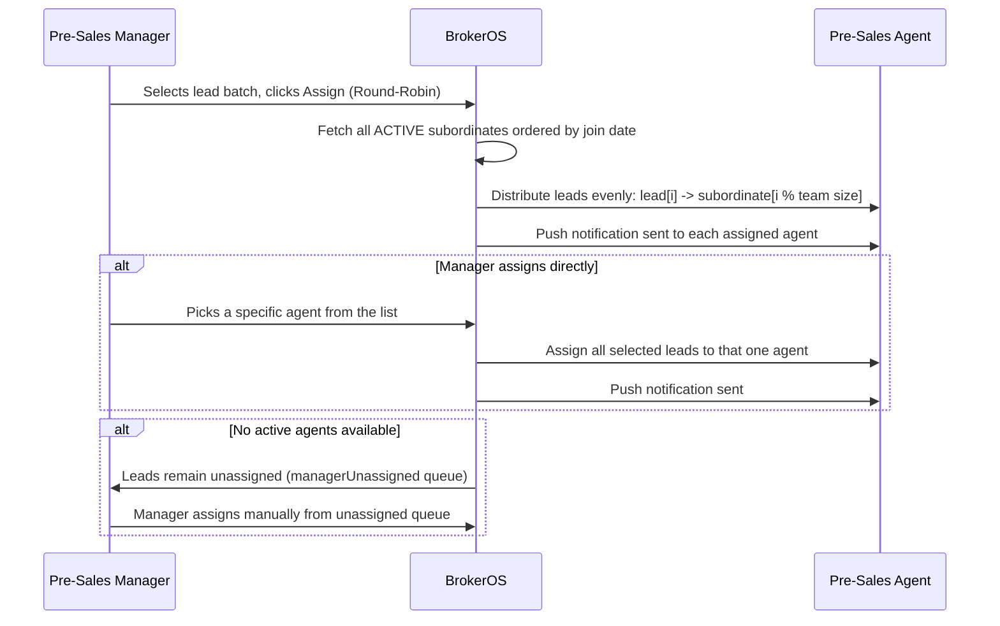

When a new lead comes in, it needs to reach the right person fast. BrokerOS handles that through two assignment modes and keeps a permanent record of every action taken on the lead.

---

## Assignment Methods

### Round-Robin

The manager selects a batch of leads and hits Assign. BrokerOS fetches all active subordinates ordered by their join date, then distributes leads using a simple index loop: lead 0 goes to agent 0, lead 1 to agent 1, and so on, wrapping back around when the list runs out. Every agent in the team gets an equal share. A push notification is sent to each agent after assignment.

### Direct Assignment

The manager picks a specific agent from the dropdown and all selected leads go to that one person. A single push notification is sent to the target agent with the count.

### Unassigned Queue

If no active agents are available, or the manager skips assignment, leads sit in the unassigned queue. The Pre-Sales Manager can view this queue filtered by `managerUnassigned: true`: it shows leads with no `assignedUserId` alongside leads assigned to the manager themselves.

---

## What Gets Logged

Every action on a lead is recorded automatically. Nothing is deleted.

| Activity | Who Triggers It | What's Captured |
| :-- | :-- | :-- |
| Call | Pre-Sales Agent via mobile dialer | Start time, duration, outcome, recording URL, AI transcript, AI summary |
| WhatsApp Message | Team inbox or broadcast | Template name, message body, delivery and read receipts |
| SMS | SMS campaign | Campaign ID, template, delivery status |
| Email | Email campaign | Open timestamp, click events, unsubscribe |
| Site Visit | Sales Executive on mobile | Scheduled date, GPS coordinates, selfie upload |
| Note | Any user | Internal note text, attached by user ID |
| Status Change | Any user or workflow | Previous status, new status, changed by, timestamp |
| Reassignment | Manager | Transferred from one agent to another with a reason |

---

## Role-Based Lead Visibility

Each role sees only the leads relevant to their job. This is enforced at the database query level, not just in the UI.

| Role | What They See |
| :-- | :-- |
| `PRE_SALES` | Only leads where `assignedUserId` is their own ID |
| `PRE_SALES_MANAGER` | All leads assigned to their direct subordinates |
| `SALES_EXECUTIVE` | Leads in `SITE_VISIT_SCHEDULED`, `SITE_VISIT_COMPLETED`, `NEGOTIATION`, `BOOKING`, scoped to their active project assignments |
| `SALES_MANAGER` | Same four statuses, across all executives reporting to them |
| `POST_SALES` | Leads whose bookings are assigned to them (`assignedPostSalesId`) |
| `POST_SALES_MANAGER` | All leads that have a confirmed direct booking |
| `CLOSING_MANAGER` | Leads they created or are assigned to |
| `SOURCING_MANAGER` | Leads they created or tied to a broker under their management |
| `CHANNEL_PARTNER` | Leads created or assigned across their entire subordinate team |
