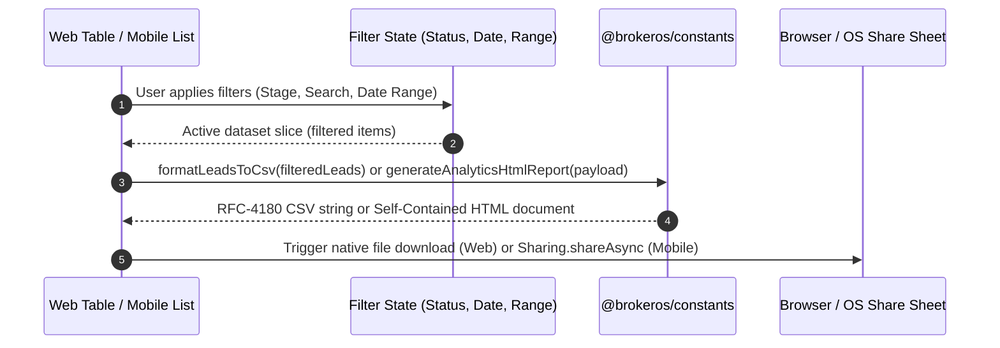

## Overview

BrokerOS provides two synchronized data export capabilities across all operational departments for both **Web (Next.js 16)** and **Mobile (Expo React Native 54)**:

1. **Filter-Aware CSV Lead and Customer Export**: In Lead Management and Customer Management tables or lists, clicking "Export CSV" extracts strictly the filtered dataset currently selected (status, date, score, or search query). If no filter is applied, it exports all accessible leads in the user scope.
2. **Time-Range-Aware HTML Analytics Report Export**: In department Analytics views, clicking "Export Report" generates a standalone, self-contained, responsive HTML report matching the currently selected time range (weekly, monthly, yearly, or all-time).

---

## Architecture Flow

---

## 1. Filter-Aware CSV Export

### Behavior Matrix

| Action | Applied Filters | Exported Dataset |
| :-- | :-- | :-- |
| Click "Export CSV" | None (All Stages) | All accessible leads in the user active view |
| Click "Export CSV" | Stage: `INTERESTED` | Only leads currently in `INTERESTED` stage |
| Click "Export CSV" | Date: `Follow-up today` | Only leads scheduled for follow-up today |
| Click "Export CSV" | Search: `"Sharma"` | Only leads matching name or phone search |

### CSV File Headers (RFC-4180 Compliant)

The shared export utility in [`packages/constants/src/export.ts`](file:///c:/Users/Sumama/Desktop/enterprise-crm-realtors/packages/constants/src/export.ts) maps records into standardized CSV columns:

- `Lead ID`: Unique database identifier
- `Full Name`: Combined first and last name
- `Phone Number`: International formatted phone number
- `Pipeline Stage`: Current lead status (`NEW`, `CONTACTED`, `INTERESTED`, etc.)
- `Sub-Status`: Detailed operational sub-status
- `Temperature`: AI categorized temperature (`HOT`, `WARM`, `COLD`)
- `AI Score`: Intent score (0 to 100)
- `Assigned Agent`: Full name of assigned telecaller or sales executive
- `Project`: Associated real estate development project
- `Last Contact`: Timestamp of most recent call or meeting
- `Next Follow-Up`: Scheduled follow-up date and time
- `Site Visit Date`: Scheduled or completed site visit timestamp
- `Site Visit Status`: Verification state of site visit
- `Created At`: Record creation timestamp
- `Broker / CP Partner`: Associated channel partner broker name (for CP inventory)

---

## 2. Time-Range-Aware HTML Analytics Reports

Department heads and executives can download standalone HTML reports from any analytics screen. The generated file is self-contained with modern CSS styles, KPI metric cards, funnel breakdown bars, and summary tables.

### Supported Departments

- **Pre-Sales Floor**: [`apps/web/app/dashboard/pre-sales/analytics/page.tsx`](file:///c:/Users/Sumama/Desktop/enterprise-crm-realtors/apps/web/app/dashboard/pre-sales/analytics/page.tsx) and [`apps/mobile/app/(dashboard)/pre-sales/analytics.tsx`](file:///c:/Users/Sumama/Desktop/enterprise-crm-realtors/apps/mobile/app/%28dashboard%29/pre-sales/analytics.tsx)
- **Pre-Sales Manager**: [`apps/web/app/dashboard/pre-sales-manager/analytics/page.tsx`](file:///c:/Users/Sumama/Desktop/enterprise-crm-realtors/apps/web/app/dashboard/pre-sales-manager/analytics/page.tsx) and [`apps/mobile/app/(dashboard)/pre-sales-manager/analytics.tsx`](file:///c:/Users/Sumama/Desktop/enterprise-crm-realtors/apps/mobile/app/%28dashboard%29/pre-sales-manager/analytics.tsx)
- **Sales Executive**: [`apps/web/app/dashboard/sales-executive/analytics/page.tsx`](file:///c:/Users/Sumama/Desktop/enterprise-crm-realtors/apps/web/app/dashboard/sales-executive/analytics/page.tsx) and [`apps/mobile/app/(dashboard)/sales-executive/analytics/index.tsx`](file:///c:/Users/Sumama/Desktop/enterprise-crm-realtors/apps/mobile/app/%28dashboard%29/sales-executive/analytics/index.tsx)
- **Sales Manager**: [`apps/web/app/dashboard/sales-manager/analytics/page.tsx`](file:///c:/Users/Sumama/Desktop/enterprise-crm-realtors/apps/web/app/dashboard/sales-manager/analytics/page.tsx) and [`apps/mobile/app/(dashboard)/sales-manager/analytics/index.tsx`](file:///c:/Users/Sumama/Desktop/enterprise-crm-realtors/apps/mobile/app/%28dashboard%29/sales-manager/analytics/index.tsx)
- **Post-Sales Floor**: [`apps/web/app/dashboard/post-sales/analytics/page.tsx`](file:///c:/Users/Sumama/Desktop/enterprise-crm-realtors/apps/web/app/dashboard/post-sales/analytics/page.tsx) and [`apps/mobile/app/(dashboard)/post-sales/analytics.tsx`](file:///c:/Users/Sumama/Desktop/enterprise-crm-realtors/apps/mobile/app/%28dashboard%29/post-sales/analytics.tsx)
- **Post-Sales Manager**: [`apps/web/app/dashboard/post-sales-manager/analytics/page.tsx`](file:///c:/Users/Sumama/Desktop/enterprise-crm-realtors/apps/web/app/dashboard/post-sales-manager/analytics/page.tsx) and [`apps/mobile/app/(dashboard)/post-sales-manager/analytics.tsx`](file:///c:/Users/Sumama/Desktop/enterprise-crm-realtors/apps/mobile/app/%28dashboard%29/post-sales-manager/analytics.tsx)
- **Sourcing Manager (CP)**: [`apps/web/app/dashboard/sourcing-manager/analytics/page.tsx`](file:///c:/Users/Sumama/Desktop/enterprise-crm-realtors/apps/web/app/dashboard/sourcing-manager/analytics/page.tsx) and [`apps/mobile/app/(dashboard)/sourcing-manager/analytics/index.tsx`](file:///c:/Users/Sumama/Desktop/enterprise-crm-realtors/apps/mobile/app/%28dashboard%29/sourcing-manager/analytics/index.tsx)
- **Closing Manager (CP)**: [`apps/web/app/dashboard/closing-manager/analytics/page.tsx`](file:///c:/Users/Sumama/Desktop/enterprise-crm-realtors/apps/web/app/dashboard/closing-manager/analytics/page.tsx) and [`apps/mobile/app/(dashboard)/closing-manager/analytics/index.tsx`](file:///c:/Users/Sumama/Desktop/enterprise-crm-realtors/apps/mobile/app/%28dashboard%29/closing-manager/analytics/index.tsx)
- **Channel Partner Head**: [`apps/web/app/dashboard/channel-partner/analytics/page.tsx`](file:///c:/Users/Sumama/Desktop/enterprise-crm-realtors/apps/web/app/dashboard/channel-partner/analytics/page.tsx) and [`apps/mobile/app/(dashboard)/channel-partner/analytics/index.tsx`](file:///c:/Users/Sumama/Desktop/enterprise-crm-realtors/apps/mobile/app/%28dashboard%29/channel-partner/analytics/index.tsx)
- **Business Manager**: [`apps/web/app/dashboard/business-manager/analytics/page.tsx`](file:///c:/Users/Sumama/Desktop/enterprise-crm-realtors/apps/web/app/dashboard/business-manager/analytics/page.tsx)

---

## 3. Web and Mobile In-App UI Paths

### Web UI Navigation

1. **Lead Tables**:
   - Path: `Dashboard -> [Department] -> Lead Management`
   - Filter Controls: Top toolbar filters (Status tabs, Date inputs, AI Score select, Search box)
   - Action: The `Export CSV (count)` button dynamically updates its count and exports the filtered rows.
2. **Analytics Views**:
   - Path: `Dashboard -> [Department] -> Analytics`
   - Filter Controls: Segmented pill controls (`Weekly`, `Monthly`, `Yearly`, `All Time`)
   - Action: Click the `Export HTML Report` button to download the standalone report matching the selected time range.

### Mobile App Navigation

1. **Lead Lists**:
   - Path: `(dashboard) -> [Department] -> Lead Management`
   - Filter Controls: Search bar and filter badges
   - Action: Tap the green `CSV (count)` button beside the search input. A native share sheet opens via `expo-sharing`.
2. **Analytics Views**:
   - Path: `(dashboard) -> [Department] -> Analytics`
   - Filter Controls: Time range selector (`Weekly`, `Monthly`, `Yearly`, `All Time`)
   - Action: Tap `Export Report` to render the HTML document and open the native system share dialog.
