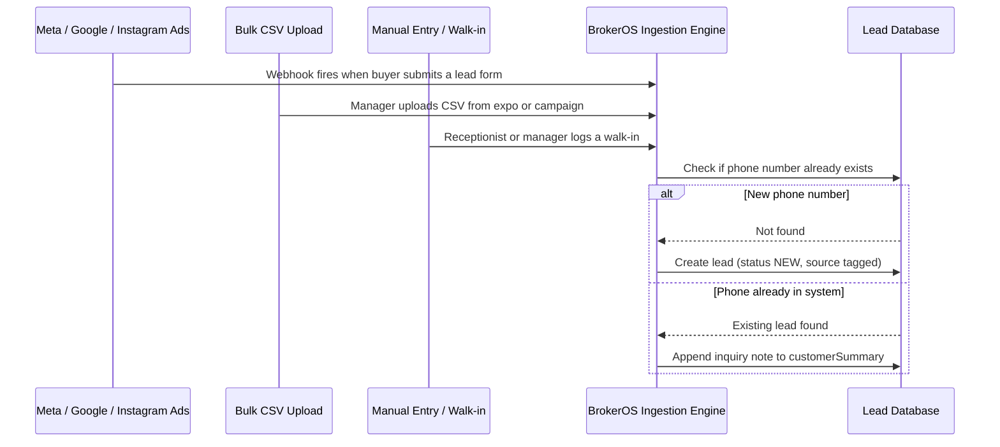

Lead ingestion is the entry point for all CRM operations. BrokerOS supports multi-channel ingestion, ensuring that prospective buyers are captured within seconds of expressing interest online or visiting a project site.

---

## How a Lead Gets In



---

## Ingestion Channels

<CardGroup cols={2}>
  <Card title="Meta & Instagram Ads" icon="meta">
    Webhook fires the moment a buyer submits a Meta instant lead form. The system fetches full field data via the Graph API and creates or updates the lead record.
  </Card>

  <Card title="Google Ads" icon="google">
    Lead form extensions on Google Search, YouTube, and Performance Max campaigns push leads via webhook. The Google Ads integration syncs field data and attribution (campaign, ad group, keyword) directly to the lead record.
  </Card>

  <Card title="Bulk CSV Upload" icon="file-csv">
    Marketing managers upload CSV files from property expos, cold databases, or past campaign lists. Rows are validated, deduplicated against existing phone numbers, and bulk-created with `status: NEW`.
  </Card>

  <Card title="Manual Entry & Walk-ins" icon="person-walking">
    Any team member can create a lead manually from the web dashboard or mobile app. For site office walk-ins, the receptionist logs the visitor directly and it enters the queue immediately.
  </Card>
</CardGroup>

---

## Deduplication

BrokerOS deduplicates on **phone number**. Every time a lead arrives from any channel, the system checks whether that phone number already exists in the database.

**If the phone is new**: a fresh lead record is created with `status: NEW` and the source is tagged.

**If the phone already exists**: no duplicate is created. Instead, the new inquiry is appended as a note to the existing lead's `customerSummary` field, and the assigned executive is notified.

---

## Lead Source Types

Every lead has a `source` field tagged at ingestion. These map directly to the `LeadSourceType` enum in the database.

| Source Type | When It's Set |
| :-- | :-- |
| `FACEBOOK_ADS` | Lead arrived via Meta lead form webhook |
| `GOOGLE_ADS` | Lead arrived via Google Ads lead form webhook |
| `INSTAGRAM` | Lead arrived via Instagram ad (Meta webhook, Instagram page) |
| `WALK_IN` | Manually logged as a site office walk-in |
| `DIRECT_CALL` | Lead created from an inbound call |
| `CHANNEL_PARTNER` | Referred by an external broker |
| `WHATSAPP` | Lead originated from a WhatsApp conversation |
| `MARKETING_CAMPAIGN` | Created as part of a voice, SMS, or email campaign |
| `MARKETING_CSV_IMPORT` | Bulk-created from a CSV file upload |
| `REFERRAL` | Word-of-mouth referral |
| `ORGANIC` | Organic inquiry (website form, direct signup) |
| `OTHER` | Any other source |

---

## Bulk CSV Format

Marketing managers can upload CSVs for batch ingestion. The expected column format is:

```csv
First Name,Last Name,Phone,Email,Budget,Preferred Location,Project Name
John,Doe, +12025550143, john.doe@example.com, 5000000, United states, Emerald Heights
Jane,Smith,+13105550198,jane.smith@example.com,10000000, United kingdom, Emerald Heights
```

<Tip>
  The `Project Name` column is matched against active projects by name. If the project name matches, BrokerOS automatically sets `interestedProjectId` on the lead record.
</Tip>
