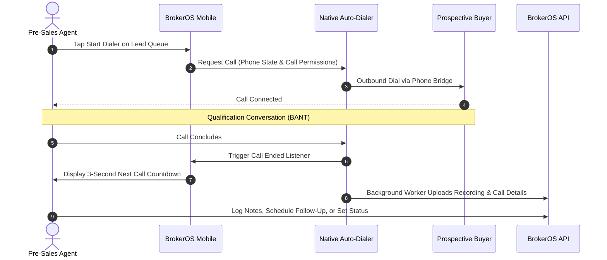

Pre-sales telecalling teams are the frontline engine of real estate brokerages. Their primary objective is to contact fresh leads quickly, qualify buyer requirements, and book verified site visits for field sales executives.

---

## The Telecalling Workflow

---

## Real Estate Qualification Framework (BANT)

Pre-sales agents use the standardized real estate BANT framework to assess buyer readiness during the initial call:

| Dimension | Qualification Questions | Desired Signal |
| :-- | :-- | :-- |
| **Budget** | _"What price range are you planning for your next home?"_ | Budget aligns within 15% of project inventory starting price. |
| **Authority** | _"Are you evaluating this investment individually or with family?"_ | Identifying if spouse or co-buyers need to join the site visit. |
| **Need** | _"Are you looking for primary residence or an investment property?"_ | Specific configuration needs: 3-bedroom, specific floor, corner unit. |
| **Timeline** | _"How soon are you planning to finalize your property purchase?"_ | Immediate: under 30 days, or short term: 1 to 3 months. |

---

## Call Dispositions

After each call, agents log the outcome directly on the lead profile or schedule the next step before moving forward:

<CardGroup cols={2}>
  <Card title="Site Visit Scheduled" icon="calendar-check">
    Lead agreed to visit the project. The agent selects a visit date, time slot, and assigns a field sales executive.
  </Card>

  <Card title="Callback Requested" icon="clock-rotate-left">
    Customer is busy or driving. The agent creates a scheduled follow-up with the requested callback date and time.
  </Card>

  <Card title="RNR / Busy" icon="phone-slash">
    Ring no answer or line busy. The call record logs the attempt, allowing the agent to retry the lead later in their queue.
  </Card>

  <Card title="Not Interested / Lost" icon="ban">
    Unqualified, out of budget, or duplicate lead. The agent marks the lead status as LOST with explanatory notes.
  </Card>
</CardGroup>

---

## Speed to Lead & Response Time

BrokerOS tracks elapsed time between lead ingestion and the first outbound call:

- **Target Response Time**: Under 5 minutes for newly submitted web or ad leads.
- **Conversion Advantage**: Calling fresh leads within minutes yields significantly higher contact rates than delayed outreach.
- **Manager Queue Visibility**: Unassigned or pending leads remain visible in the manager queue so pre-sales managers can rebalance assignments across active agents.
