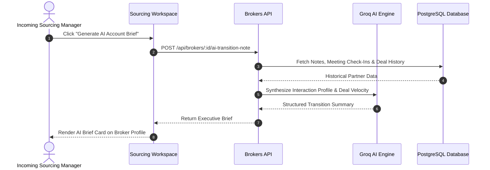

In the Channel Partner (CP) business model, external real estate brokers and independent agencies serve as the primary sales distribution channel. Sourcing Managers manage broker partnerships across regional territories, ensuring continuous deal flow to developer projects flagged with `isCpProject = true`.

---

## The Broker Entity

External brokers are **not** system users. They do not log into the internal CRM dashboard; rather, they are modeled as commercial business records managed by Sourcing Managers:

| Field Attribute | Purpose & Description |
| :-- | :-- |
| **`brokerCode`** | Unique partner identifier (for example, `BRK-1042`) used on booking forms and tracking links. |
| **`name`** | Full legal name of the principal broker or managing partner. |
| **`companyName`** | Registered real estate brokerage or agency trade name. |
| **`phone` / `alternatePhone`** | Primary mobile contact and secondary office line. |
| **`email`** | Commercial email used for digital commission invoices and payment advice slips. |
| **`reraNumber` / `reraState`** | State real estate licensing authority registration details. |
| **`gstNumber`** | Corporate tax registration number for tax deduction and invoice reconciliation. |
| **`status`** | Partner lifecycle state: `NEW`, `VERIFIED`, `ACTIVE`, `INACTIVE`, or `BLOCKED`. |
| **`sourcingManagerId`** | Assigned internal relationship manager accountable for agency production. |
| **`serviceAreas`** | Array of target sub-markets, neighborhoods, or property micro-locations. |

---

## Broker Performance Tiers

Brokers are classified into performance tiers based on verified closing volume. Tiers determine commission slabs, priority access to new project launches, and exclusive incentives:

| Tier | Quarterly Closures | Commission Slab | Privileges & Priority |
| :-- | :-- | :-- | :-- |
| **`PLATINUM`** | 10+ Bookings | 3.0% to 4.0% | Dedicated on-site closing executive, 72-hour pre-launch inventory hold privilege, executive incentive trips. |
| **`GOLD`** | 5 to 9 Bookings | 2.5% to 3.0% | 48-hour pre-launch access, customized marketing collateral kits, priority site lounge hosting. |
| **`SILVER`** | 2 to 4 Bookings | 2.0% to 2.5% | Standard project listings, branded digital floor plans, regular launch webinar invitations. |
| **`BRONZE`** | 0 to 1 Bookings | 1.5% to 2.0% | Default tier for newly onboarded or unverified agency partners. |

---

## Active Deal Cards and Pipeline Tracking

Sourcing Managers monitor active client referrals from each broker using visual **Deal Cards**:

- **Referred**: The broker registers the prospective buyer contact or submits a digital lead referral.
- **Site Visit Completed**: The buyer arrives at the project sales lounge with the broker and completes an architectural tour with a Closing Manager.
- **In Negotiation**: Unit selection confirmed; price, floor rise charges, and milestone schedules are under active discussion.
- **Booked**: Token deposit received and verified; unit locked and commission record generated in the broker ledger.

---

## AI Account Handoff and Transition Notes

When territories are reorganized, or when a Sourcing Manager changes roles, incoming relationship managers require immediate context on broker personalities, preferred commission models, and active deals.

BrokerOS provides an AI-assisted handoff tool accessible via `POST /api/brokers/:id/ai-transition-note`:



### Transition Brief Output Example

```json
{
  "summary": "Marcus Vance manages a team of 15 agents at Apex Realty in the Westside corridor. Responsible for 8 confirmed bookings in Tower A over the last two quarters. Prefers rapid commission disbursements within 15 days of agreement execution. Currently pitching 3 high-net-worth buyers for Tower B penthouses.",
  "recommendedAction": "Schedule an in-person luncheon this Thursday to present early allocation incentives for the upcoming Phase 2 launch."
}
```
