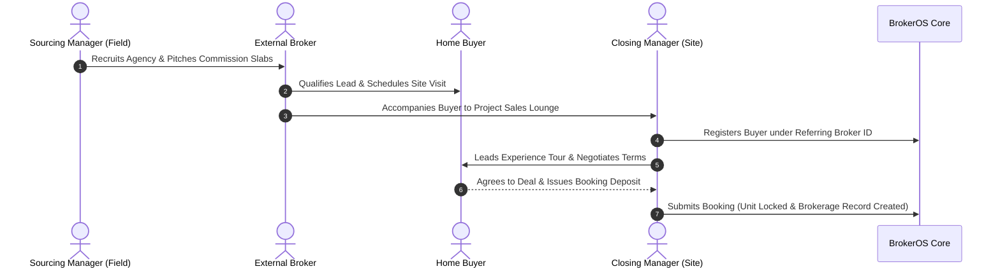

The Channel Partner network manages external real estate brokers and independent agents who sell developer project units under commercial brokerage agreements.

All Channel Partner activities operate under a strict commercial partition: **`Project.isCpProject = true`**. Projects with `isCpProject = false` belong exclusively to internal sales teams and never mix inventory, leads, or commission accounting with external broker networks.

---

## The CP Operational Triangle

The external broker model functions as a three-way coordination between the external agency, the field relationship manager, and the on-site closer:

---

## Core Roles in the Channel Partner Ecosystem

### Sourcing Manager (`SOURCING_MANAGER`)

- Recruits external brokerages into the firm's partner network.
- Conducts GPS-verified field meetings at broker agency offices.
- Gathers regulatory and bank KYC documents for compliance clearance.
- Communicates project launch dates, commission tiers, and promotional incentives.

### Closing Manager (`CLOSING_MANAGER`)

- Stationed physically at the developer project sales lounge or experience centre.
- Welcomes referring brokers and their prospective buyer clients upon arrival.
- Leads architectural scale model tours, unit floor plan presentations, and sample flat walkthroughs.
- Negotiates commercial terms within approved discount slabs and executes booking application forms.

### Channel Partner Executive (`CHANNEL_PARTNER`)

- Senior commercial lead overseeing broker operations across multiple developments.
- Manages high-level builder relationship agreements and inbound commission terms.
- Resolves broker attribution conflicts and approves bulk settlement disbursement batches.

---

## Financial Flow and Accounting Records

Every Channel Partner transaction generates an immutable financial paper trail across three linked records:

| Record Model | Financial Role | Accounting Mechanics |
| :-- | :-- | :-- |
| **`InboundCommission`** | Developer Receivable | Tracks the gross commission owed by the property developer to the brokerage firm (for example, 4.0% of agreement value). |
| **`BrokerageRecord`** | Outbound Broker Payable | Automatically generated upon booking confirmation. Calculates the broker's contracted cut (for example, 2.5% base plus tier bonuses). |
| **`BrokerageSettlement`** | Bank Disbursement Batch | Manages the actual bank wire transfer, statutory tax withholdings, and proof-of-payment receipts once milestone criteria are met. |
