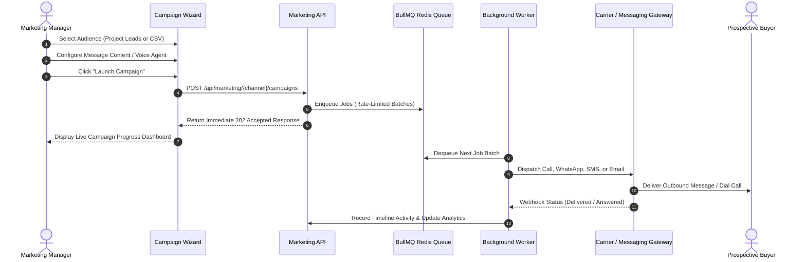

The Marketing Suite enables brokerage firms to engage thousands of prospective buyers simultaneously across every communication channel they use: phone calls, WhatsApp, SMS, and email: all coordinated from a centralized command center.

---

## Omnichannel Channel Suite

BrokerOS connects native communications infrastructure directly to CRM lead and inventory databases:

<CardGroup cols={2}>
  <Card title="AI Voice & Telephony" icon="microphone-lines" href="/marketing/voice/overview">
    Dial thousands of leads with human-like AI voice agents on real phone lines via carrier bridges, qualifying prospect budgets and scheduling visits in real time.
  </Card>

  <Card title="WhatsApp Business" icon="whatsapp" href="/marketing/whatsapp/overview">
    Broadcast announcements, manage a multi-agent team inbox, build interactive chatbot flows, and run automated nurture drips via Meta Cloud API.
  </Card>

  <Card title="SMS Campaigns" icon="message" href="/marketing/sms/overview">
    Run high-throughput SMS broadcasts with live mobile preview mockups, branded short-link tracking, and two-way inbound conversation handling.
  </Card>

  <Card title="Email Marketing" icon="envelope" href="/marketing/email/overview">
    Design responsive HTML property launch newsletters, manage domain DNS authentication, and track engagement opens and link clicks in real time.
  </Card>

  <Card title="Ad Lead Ingestion" icon="rectangle-ad" href="/marketing/ads/overview">
    Automatically ingest leads from Meta, Facebook, Instagram, Google Search, and YouTube campaigns with sub-second CRM syncing and attribution tagging.
  </Card>
</CardGroup>

---

## Campaign Execution Architecture

Every campaign in BrokerOS follows an asynchronous lifecycle powered by BullMQ background workers:

---

## Commercial Boundary and Project Scoping

Every marketing campaign is strictly scoped to an active property development:

- **Audience Protection**: The audience picker automatically limits selections to leads mapped to the selected project. This guarantees that internal brokerage campaigns (`isCpProject = false`) never inadvertently message Channel Partner investor databases (`isCpProject = true`).
- **Dynamic Variable Personalization**: Templates and AI voice prompts dynamically inject property-specific parameters, such as project name, starting price, RERA registration, and sales lounge address.

---

## Asynchronous Worker Processing

BrokerOS decouples campaign launching from API request lifecycles using dedicated BullMQ workers:

- **Non-Blocking Architecture**: Launching a campaign targeting 50,000 contacts enqueues jobs in milliseconds. You can safely close your browser or navigate to other CRM modules while background processors handle delivery.
- **Dedicated Queue Processors**:
  - `marketing-voice.processor.ts`: Normalizes lead variables and dispatches calls via carrier bridges.
  - `marketing-whatsapp.processor.ts`: Orchestrates template message dispatches and rate-limiting.
  - `marketing-sms.processor.ts`: Encodes GSM/Unicode messages and wraps trackable short links.
  - `marketing-email.processor.ts`: Renders responsive HTML templates and signs headers.
- **Rate-Limiting and Carrier Throttling**: Background processors respect carrier dialer concurrency limits and messaging gateway TPS (transactions per second) boundaries to protect phone number reputation.
