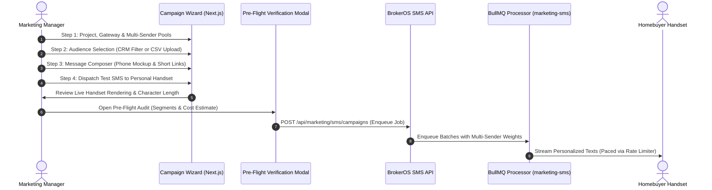

## Streamlined SMS Broadcast Creation

The BrokerOS SMS Campaign Wizard (`/dashboard/marketing/sms/campaigns/new`) guides marketing managers through drafting, audience segmentation, phone mockup preview, credit auditing, and dispatch scheduling.

Integrated directly with multi-gateway sender pooling and background telecom rate limiters, the wizard ensures high throughput across large lead volumes while maintaining carrier compliance.

---

## Campaign Dispatch Lifecycle

---

## The Four Wizard Configuration Steps

### Project, Gateway, and Multi-Sender Pools

- **Project Association**: Binds the campaign to a specific development (for example, _Skyline Residences_ or _Grandview Towers_).
- **Sender Pool Allocation**: Select one or multiple verified phone numbers or alphanumeric sender headers (`CampaignSmsSenderPoolConfig`). Choose **Auto Even** distribution or specify **Custom Percentages** across gateway numbers to prevent telecom throttling.
- **Gateway Provider**: Select from configured integrations (Twilio, AWS SNS, Gupshup, Sinch, Infobip, Telnyx, Plivo, Vonage, Bird).

### Target Audience and DND Scrubbing

- **CRM Lead Filters**: Segment prospects by assigned project, lead pipeline status (`NEW`, `CONTACTED`, `INTERESTED`), qualification temperature, or budget bracket ($$\ge \$$650,000\$).
- **CSV List Ingest**: Upload external investor contact lists with automatic header column detection and E.164 phone normalization.
- **Regulatory DND Scrubbing**: Automatically excludes phone numbers registered on National Do Not Disturb registries and contacts who have previously opted out.

### Message Composer and Interactive Phone Mockup

- **Message Composer**: Draft copy with real-time GSM-7 vs Unicode character and segment counters.
- **Dynamic Merge Tag Chips**: Insert personalized variables (`{{lead.firstName}}`, `{{project.name}}`, `{{project.startingPrice}}`, `{{advisor.phone}}`).
- **Interactive Phone Simulator**: Renders text appearance inside an interactive smartphone mockup in real time.
- **Branded Short Link Insertion**: Compress landing page or brochure PDF URLs into unique 22-character tracking links (`https://brk.os/s/{token}`) to conserve segment limits and log clicks.

### Pre-Flight Audit, Test Send, and Schedule

- **Live Test SMS**: Dispatch an immediate live proof to your smartphone to verify carrier delivery and formatting.
- **Pre-Flight Segment & Cost Estimator**: Inspect projected billable segments and telecom credit expenditures across chosen gateways.
- **Carrier Throughput Check**: Warns if message volume exceeds single-number carrier limits, suggesting additional sender pool allocation.
- **Dispatch Scheduling**: Choose between **Send Immediately** or schedule for high-open windows (such as weekdays from 10:00 AM to 12:00 PM).
