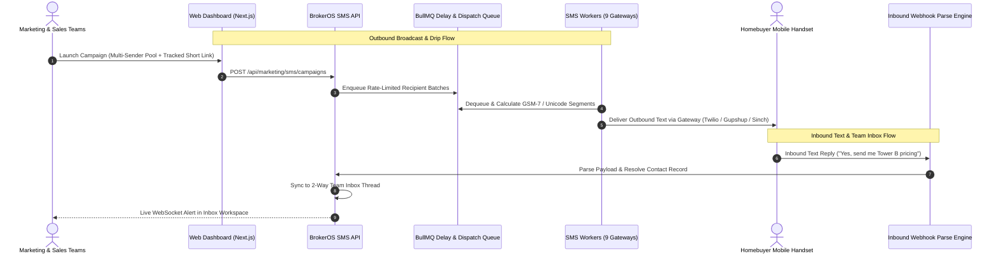

## Enterprise Real Estate SMS Platform

With open rates exceeding 90% within three minutes of delivery, SMS is the most immediate communication channel available to real estate developers and brokerage firms. Whether announcing limited-phase price revisions, reminding prospects of weekend property tours, or following up on missed sales calls, text messages command immediate buyer attention.

BrokerOS delivers an enterprise SMS marketing suite directly tied to the core CRM database. Outbound mass broadcasts, multi-gateway sender pooling, automated DND and regulatory compliance (DLT & 10DLC), visual automation flows, and a 2-way collaborative team inbox operate within a single unified workspace.

---

## Unified SMS Architecture

---

## Core SMS Modules

<CardGroup cols={2}>
  <Card title="2-Way Team Inbox" icon="inbox" href="/marketing/sms/team-inbox">
    Collaborative shared text inbox with real-time thread continuity, sales agent assignment, character counters, and AI smart reply drafting.
  </Card>

  <Card title="Automation Flows" icon="diagram-next" href="/marketing/sms/sms-flows">
    Visual drag-and-drop canvas for automated SMS journeys, keyword auto-replies (`YES`, `PRICE`, `VISIT`), Groq AI Concierge responses, and branching conditions.
  </Card>

  <Card title="Campaign Wizard" icon="wand-magic-sparkles" href="/marketing/sms/campaign-wizard">
    Step-by-step broadcast builder with multi-gateway sender pools, phone mockup preview, DND compliance scrubbing, and scheduling.
  </Card>

  <Card title="Sender Pools & Pre-Flight" icon="shield-halved" href="/marketing/sms/preflight-and-sender-pools">
    Multi-gateway sender pooling across virtual numbers to prevent carrier throttling, pre-flight segment calculations, and cost estimation.
  </Card>

  <Card title="Template Registry & DLT" icon="file-lines" href="/marketing/sms/template-registry">
    Regulatory template management supporting Indian DLT (Entity ID, Header ID, Template ID) and US A2P 10DLC compliance.
  </Card>

  <Card title="Tracked Short Links" icon="link" href="/marketing/sms/short-links">
    High-density branded URL shortener (`https://brk.os/s/{token}`) with sub-second redirection, individual lead click attribution, and CRM score boosts.
  </Card>

  <Card title="AI Assistant & Settings" icon="sparkles" href="/marketing/sms/ai-assistant-and-settings">
    Configure Groq language models (`openai/gpt-oss-120b`), 160-character single-segment constraints, carrier diagnostics, and CRM tags.
  </Card>

  <Card title="Gateway Integrations" icon="puzzle-piece" href="/marketing/sms/gateway-integrations">
    Direct connectors for 9 enterprise telecom aggregators: Twilio, AWS SNS, Gupshup, Sinch, Infobip, Telnyx, Plivo, Vonage, and Bird.
  </Card>
</CardGroup>

---

## Real-Time Performance Benchmarks

Every SMS broadcast tracks carrier receipts and link interaction to measure deliverability and customer intent:

| Metric | Operational Definition | Target Enterprise Benchmark |
| :-- | :-- | :-- |
| **Delivered Rate** | Percentage of sent text messages successfully confirmed on recipient handsets. | $$\ge 97.0\%$$ |
| **Unique Click Rate** | Proportion of delivered recipients who tapped the embedded short link. | $$10\%$$ to $$18\%$$ |
| **Direct Reply Rate** | Inbound text replies received on Virtual Long Numbers within 72 hours. | $$4\%$$ to $$8\%$$ |
| **Failed / Undelivered** | Invalid phone numbers or carrier network rejections automatically logged. | $$< 1.5\%$$ |
| **Opt-Out Rate** | Unsubscribe keywords (`STOP`, `UNSUB`) processed automatically. | $$< 0.15\%$$ |

---

## Multi-Channel Lead Progression

Interactions within the SMS suite feed directly into sales rep workflows:

- **Short Link Tap**: Clicking a digital brochure short link automatically adds 10 points to the lead's CRM qualification score.
- **Inbound Text Response**: Replying to an SMS notification immediately routes the conversation into the Team Inbox and notifies the assigned sales executive via push notification.
- **Automated Fallback to Voice**: If an urgent unit hold or appointment reminder remains unacknowledged after 4 hours, BrokerOS can automatically trigger a companion AI Voice call.
