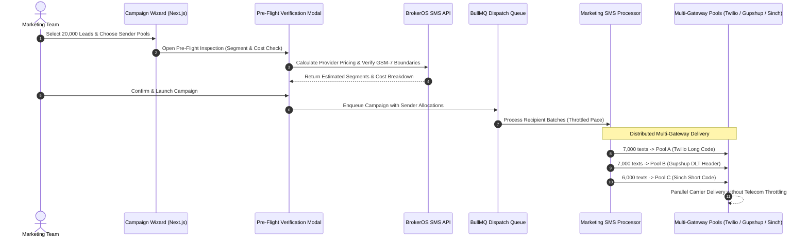

## Multi-Gateway Sender Pooling for High Throughput

Attempting to broadcast 25,000 text messages through a single Virtual Long Number (VLN) causes severe telecom carrier throttling. Standard 10DLC or long-code numbers are throttled at 1 to 10 messages per second by wireless carriers (such as Verizon, AT&T, and Vodafone), causing delivery backlogs that delay urgent price-sensitive real estate announcements.

BrokerOS resolves this bottleneck through **Multi-Gateway Sender Pooling** (`CampaignSmsSenderPoolConfig`) and an automated **Pre-Flight Delivery Verification** engine (`SmsPreFlightModal.tsx`).

---

## Sender Pool Architecture

---

## Sender Pool Allocation Modes

When configuring an SMS broadcast in the Campaign Wizard, marketing managers can distribute audience volume across multiple verified phone numbers and sender IDs:

| Distribution Mode | Configuration Behavior | Strategic Use Case |
| :-- | :-- | :-- |
| **`AUTO_EVEN`** | Evenly divides the total audience volume across all selected phone numbers or sender IDs in the pool. | Routine large-scale property announcements across balanced virtual numbers. |
| **`CUSTOM_PERCENTAGE`** | Allows assigning specific percentage weights per sender number (for example, 60% on high-throughput short code, 40% on secondary local number). | Balancing traffic between promotional short codes and local area code numbers. |

---

## Pre-Flight Verification Modal

Before executing a broadcast, the **Pre-Flight Modal** (`SmsPreFlightModal.tsx`) performs a mandatory delivery and financial audit:

### Automated Segment Analysis

Evaluates the message text to identify the exact character encoding and segment boundaries:

- **Character Count**: Exact count of characters in the message body.
- **Encoding Type**: Identifies whether the copy uses standard **GSM-7** (up to 160 characters for single segment) or **Unicode** (reduced to 70 characters due to emojis or special characters).
- **Total Billable Segments**: Computes total segments across the entire audience ($$\text{Total Leads} \times \text{Segments per Lead}$$).

### Gateway Cost Estimation Breakdown

Calculates projected telecommunication expenditure across selected gateways based on standard benchmark rates (`SMS_PROVIDER_PRICING_ESTIMATES`):

| SMS Gateway | Benchmark Cost per Segment | Primary Geographic Strength |
| :-- | :-- | :-- |
| **Twilio** | ~\$0.0079 / segment | North America, Europe, Global |
| **AWS SNS / Pinpoint** | ~\$0.0065 / segment | Global High-Throughput Cloud Relay |
| **Gupshup** | ~\$0.0022 / segment | India DLT Enterprise Relay |
| **Sinch** | ~\$0.0075 / segment | Europe, Latin America, North America |
| **Infobip** | ~\$0.0072 / segment | Global Enterprise Carrier Connections |
| **Telnyx** | ~\$0.0040 / segment | Private Telephony Network & Direct Peering |
| **Plivo** | ~\$0.0055 / segment | North America & Global Transit |
| **Vonage (Nexmo)** | ~\$0.0068 / segment | Global Tier-1 Aggregation |

---

## Provider Rate Throttling in BullMQ Workers

The background processor (`marketing-sms.processor.ts`) respects provider-specific throughput limits (`SMS_PROVIDER_THROTTLE_LIMITS`) to ensure carrier compliance:

- **Twilio**: Paced to stay within MPS (Messages Per Second) limits allocated to the Messaging Service SID.
- **AWS SNS**: Regulated according to AWS account spend quotas and destination country throughput.
- **Gupshup**: Paced to comply with Indian telecom DLT promotional throughput rules.
- **Automatic Recovery**: Transient carrier failures or `429 Too Many Requests` responses are rescheduled with exponential backoff.
