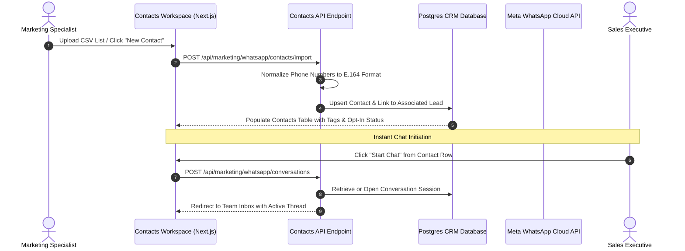

## Centralized WhatsApp Contact Directory

The BrokerOS WhatsApp Contact Directory (`/dashboard/marketing/whatsapp/contacts`) provides a centralized database of all opted-in leads, prospective buyers, and previous customers communicating over your official WhatsApp Business Account.

Unlike fragmented chat lists where customer records remain isolated from CRM deals, every WhatsApp contact synchronizes with core CRM lead records, preserving historical deal context, property requirements, and conversation logs.

---

## Contact Lifecycle and Synchronization Architecture

---

## The 5-Tab Contact Detail Drawer

Clicking any contact row opens the comprehensive **Contact Detail Drawer** (`ContactDetailDrawer.tsx`), providing 360-degree visibility into the customer's profile:

### Overview Tab

- **Contact Identity**: Full name, verified mobile number in E.164 format, and email address.
- **Project Association**: Displays the primary development the buyer inquired about (for example, _Skyline Residences_).
- **Lead Score and Temperature**: Visual badges indicating whether the contact is `HOT`, `WARM`, or `COLD`.
- **Opt-In Status**: Verification of WhatsApp messaging consent and date of opt-in.

### Deals and Bookings Tab

- **Site Visit Records**: Log of scheduled, completed, and GPS-verified on-site property walkthroughs.
- **Active Unit Holds**: Real-time status of temporary unit holds placed on inventory.
- **Confirmed Bookings**: Links to booked unit agreements, customer conversion records, and deposit payment status.

### Internal Notes Tab

- **Collaboration History**: Staff-only notes left by telecallers, sourcing managers, and closing executives.
- **Inline Note Creation**: Sales agents can append new timestamps and observations directly from the drawer without navigating away.

### Custom Fields Tab

- **Property Requirements**: Stated typology preferences (such as 3-Bedroom Penthouse or Ground-Floor Garden Villa).
- **Budget Bracket**: Target purchase budget (for example, $$750,000 to $$1,000,000).
- **Investment Classification**: Categorized tags (such as `#First_Time_Buyer`, `#NRI_Investor`, `#Corporate_Relocation`).

### Send Template Tab

- **Direct Template Dispatch**: When the 24-hour free-form messaging window has expired, agents can select and send any pre-approved Meta template directly from the drawer to reopen the dialogue.

---

## Bulk Contact Import and CSV Ingest

The **Import Contacts Modal** (`ImportContactsModal.tsx`) enables importing large audience lists:

1. **Upload File**: Drag and drop standard `.csv` contact lists.
2. **Column Mapping**: Match CSV headers to BrokerOS contact properties:
   - Full Name
   - Phone Number (auto-normalized to E.164 format)
   - Email Address
   - Budget Range
   - Project Name
3. **Audience Tagging**: Assign batch tags to the imported cohort (for example, `#HNI_Launch_List`, `#Webinar_Attendees`).
4. **Broadcast Enrollment**: Immediately designate the imported list as a target audience for mass template broadcasts.
