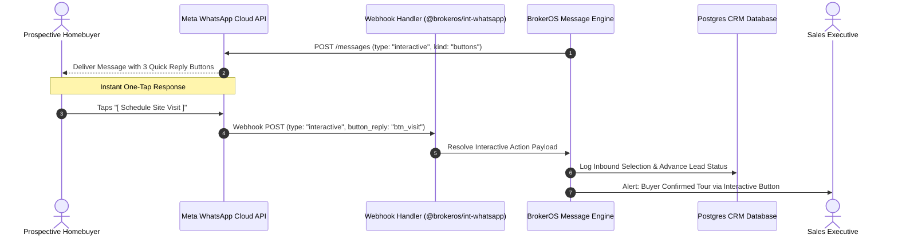

## Eliminating Typing Friction for Homebuyers

In commercial real estate, asking prospective buyers to type long text replies on mobile keyboards results in high drop-off rates. Meta WhatsApp Cloud API **Interactive Messages** resolve this friction by offering structured, clickable tap controls that prompt immediate customer engagement.

The BrokerOS Interactive Message Studio (`InteractiveBuilder.tsx`) enables marketing and sales teams to construct Quick Reply buttons and multi-section List Menus with real-time validation against Meta API structural limits.

---

## Interactive Messaging Architecture

---

## The Two Interactive Message Formats

BrokerOS supports both official Meta interactive formats:

<CardGroup cols={2}>
  <Card title="Quick Reply Buttons" icon="reply">
    Presents up to **3 clickable button pills** beneath the message bubble. Tapping any button immediately sends a structured text response without opening the phone keyboard.
  </Card>

  <Card title="List Menu Messages" icon="list-check">
    Presents a clean **menu drawer button** that expands into a structured menu supporting up to **10 selectable rows** grouped across organized sections.
  </Card>
</CardGroup>

---

## Structural Specifications and Limits

The Interactive Message Studio strictly enforces Meta Cloud API constraints (`INTERACTIVE_LIMITS`) to prevent API rejection:

| Component Attribute | Quick Reply Buttons Limit | List Menu Limit | Description |
| :-- | :-- | :-- | :-- |
| **Header (Optional)** | 60 characters | 60 characters | Text header or bold announcement title. |
| **Body (Mandatory)** | 1,024 characters | 1,024 characters | The primary real estate proposition or inquiry copy. |
| **Footer (Optional)** | 60 characters | 60 characters | Muted gray disclaimer or brokerage contact note. |
| **Action Label** | N/A | 20 characters | The text displayed on the menu button (for example, `Select Unit Type`). |
| **Total Options** | Max 3 buttons | Max 10 items total | Total selectable choices presented to the buyer. |
| **Button / Row Title** | 20 characters | 24 characters | The primary option title (for example, `3BHK Luxury Penthouse`). |
| **Row Description** | N/A | 72 characters | Secondary descriptive subtitle (for example, `2,450 sq.ft. with private pool terrace`). |

---

## Real-Time Mobile Preview Simulator

The **Interactive Preview Simulator** (`InteractivePreview.tsx`) renders the exact appearance of your message inside a high-fidelity WhatsApp chat viewport as you build:

- **Button Rendering**: Previews pill button width, text centering, and truncation warnings if a title exceeds 20 characters.
- **List Drawer Expansion**: Simulates how the list sheet opens on iOS and Android devices, ensuring section headers and row descriptions maintain readable visual hierarchy.
- **Validation Engine**: Flags missing mandatory fields or invalid payloads before you send or save the message.

---

## Inbound Payload Resolution and CRM Actions

When a buyer taps an interactive button or list item, Meta transmits a specialized webhook payload (`interactive.button_reply` or `interactive.list_reply`):

- **Zero Ambiguity**: Unlike unstructured text where buyers might type _"maybe saturday"_ or _"tell me more"_, interactive payloads transmit an explicit identifier (`id: "btn_tour_saturday"`).
- **Instant Branching**: Chatbot flows immediately advance along the corresponding path without requiring complex NLP intent parsing.
- **CRM Syncing**: The selected typology or project interest is instantly persisted to the lead's CRM profile attributes.
