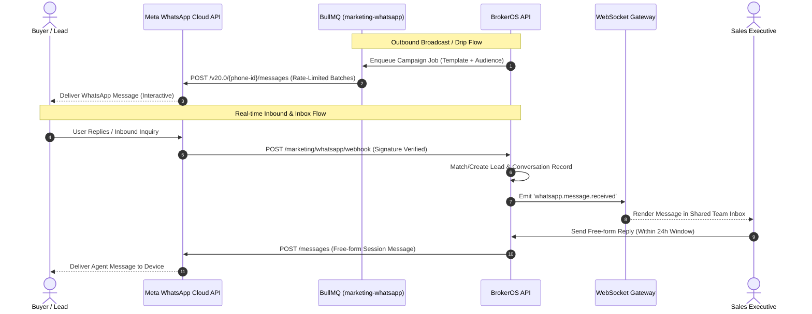

## Enterprise WhatsApp Architecture

BrokerOS integrates directly with the official **Meta WhatsApp Cloud API** through the dedicated `@brokeros/int-whatsapp` package. Designed for high-volume brokerage operations, the system handles incoming buyer inquiries, broadcasts project launches, and synchronizes real-time conversation state directly with CRM lead records.

Operating on the official Cloud API guarantees:

- Verified Business Profile status with green badge verification.
- Direct delivery through Meta global infrastructure with no third-party intermediary latency.
- Full compliance with Meta business messaging policies and 24-hour customer service window guidelines.
- Support for interactive components including Quick Reply buttons, List Menus, CTA URLs, phone dialers, and media headers (PDF brochures, images, walkthrough videos).

---

## Architecture and Execution Flow

---

## Core WhatsApp Modules

<CardGroup cols={2}>
  <Card title="Team Inbox" icon="inbox" href="/marketing/whatsapp/team-inbox">
    Unified multi-agent shared inbox for real-time customer conversations. Includes agent assignment, internal team notes, quick replies, and lead status syncing.
  </Card>

  <Card title="Contact Directory" icon="address-book" href="/marketing/whatsapp/contacts">
    Centralized WhatsApp contact management, CSV audience list import, custom field tracking, and 5-tab Lead 360 detail drawers.
  </Card>

  <Card title="Broadcast Campaigns" icon="tower-broadcast" href="/marketing/whatsapp/broadcasts">
    High-throughput messaging to segmented leads or imported CSV lists using Meta-approved utility and marketing templates with live read receipt tracking.
  </Card>

  <Card title="Tiers, Pricing & Pre-Flight" icon="shield-halved" href="/marketing/whatsapp/preflight-and-tiers">
    Meta messaging tiers (1K to Unlimited), phone quality score protection, conversation category pricing, and pre-flight capacity audits.
  </Card>

  <Card title="Interactive Messages" icon="hand-pointer" href="/marketing/whatsapp/interactive-messages">
    Build zero-typing Quick Reply buttons and multi-section List Menus validated against Meta API limits with real-time mobile preview.
  </Card>

  <Card title="Chatbot Flows" icon="diagram-next" href="/marketing/whatsapp/chatbot-flows">
    Visual no-code conversation builder for automated lead qualification, project brochure delivery, FAQs, and instant site visit booking.
  </Card>

  <Card title="Drip Automations" icon="calendar-days" href="/marketing/whatsapp/drip-automations">
    Multi-stage automated messaging sequences triggered by lead creation, stage transitions, or site visit follow-ups across structured day intervals.
  </Card>

  <Card title="Visual Pipelines" icon="bars-progress" href="/marketing/whatsapp/pipelines">
    Kanban-style conversation management board mapping chats across qualification stages from initial discovery to contract signing.
  </Card>

  <Card title="Template Manager" icon="file-invoice" href="/marketing/whatsapp/template-manager">
    Create, preview, submit, and track approval status for Meta templates across Marketing, Utility, and Authentication categories.
  </Card>

  <Card title="AI Assistant & Settings" icon="sparkles" href="/marketing/whatsapp/ai-assistant-and-settings">
    Configure Groq language models (`openai/gpt-oss-120b`), custom system prompts, HMAC-SHA256 webhook diagnostics, and CRM tags.
  </Card>
</CardGroup>

---

## Message Types and Service Windows

Meta enforces strict distinction between pre-approved template messages and free-form session messages:

| Message Classification | Allowed Timing | Meta Pre-Approval Required | Typical Use Case |
| :-- | :-- | :-- | :-- |
| **Business-Initiated (Template)** | Anytime (with opted-in recipients) | Required (Meta review: 2 to 60 mins) | Project announcements, payment alerts, appointment confirmations, drip sequences |
| **User-Initiated (Session Window)** | Within 24 hours of customer's last message | Not required (Free-form text, audio, images) | Sales agent 1-on-1 chats, negotiation discussions, real-time customer support |

<Note>
  Every inbound message from a lead resets the **24-hour customer service window**. During this window, sales agents can communicate freely without paying template conversation fees or requiring pre-approved copy. Once the window expires, outgoing communication must initiate via an approved template message.
</Note>
