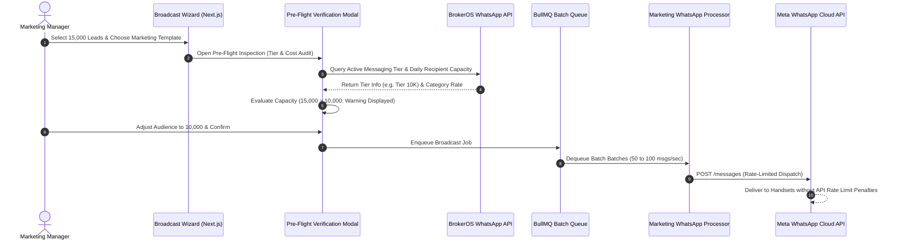

## Enterprise WhatsApp Scale and Deliverability

Deploying large-scale marketing campaigns over WhatsApp requires navigating Meta Business Messaging policies. Meta regulates outbound marketing volume using daily unique recipient limits (Messaging Tiers) and monitors recipient feedback (Phone Quality Ratings) to protect user experience.

BrokerOS manages these constraints through an integrated **Pre-Flight Launch Verification** engine (`WhatsAppPreFlightModal.tsx`) and background BullMQ batch pacing, ensuring maximum throughput without endangering your business phone number's health.

---

## Pre-Flight Verification Architecture

---

## Meta Messaging Tiers and Daily Limits

Meta assigns each verified WhatsApp Business phone number a daily messaging tier regulating the number of unique customers it can contact in a rolling 24-hour window:

| Messaging Tier | 24-Hour Unique User Capacity | Advancement Criteria |
| :-- | :-- | :-- |
| **Tier 1 (1K)** | **1,000 unique recipients** | Initial tier for newly verified business numbers. |
| **Tier 2 (10K)** | **10,000 unique recipients** | Maintain High quality rating while sending 50% of capacity over 7 consecutive days. |
| **Tier 3 (100K)** | **100,000 unique recipients** | Maintain High quality rating across high-volume enterprise broadcasting. |
| **Tier 4 (Unlimited)** | **Unlimited recipients** | Top tier reserved for high-reputation, high-volume enterprise brands. |

<Warning>
  **Phone Quality Rating Safeguard**: Meta evaluates recipient sentiment based on how often users tap **Block** or **Report Spam**. If your rating drops from _High (Green)_ to _Low (Red)_, Meta temporarily restricts your tier. BrokerOS automatically suspends campaign dispatch if failure or block rates exceed **2%**.
</Warning>

---

## Meta Conversation Category Pricing

Meta bills WhatsApp messaging based on 24-hour conversation sessions across four distinct categories (`WA_CONVERSATION_PRICING`):

| Category | Typical Real Estate Use Case | Pricing Profile |
| :-- | :-- | :-- |
| **Marketing** | Project launch announcements, phase openings, digital brochures, price reduction alerts. | Standard marketing conversation fee; requires pre-approved marketing template. |
| **Utility** | Site visit appointment confirmations, payment receipts, escrow milestone demand letters. | Lower utility conversation fee; requires pre-approved utility template. |
| **Authentication** | One-Time Password (OTP) verification codes for client portal access or digital booking signing. | Lowest rate tier; strict pre-approved authentication format. |
| **Service (User-Initiated)** | Inbound buyer inquiries where an agent replies within the 24-hour customer service window. | Flat customer service rate; free-form text and media permitted without template fees. |

---

## Pre-Flight Verification Modal

Before launching any broadcast campaign, the **Pre-Flight Modal** (`WhatsAppPreFlightModal.tsx`) executes an automated delivery audit:

- **Tier Capacity Verification**: Checks target audience size against your active messaging tier daily limit (`dailyLimit`). If the broadcast exceeds daily capacity (`isTierExceeded`), the modal warns the user to avoid message throttling.
- **Cost Estimation**: Calculates total estimated expenditure in both USD and local currency (`calculateWhatsAppBroadcastCost`) based on target volume and template category.
- **Template Status Confirmation**: Confirms that the selected template remains in `APPROVED` status on Meta Graph API and has not been flagged or paused.
- **Schedule Time Check**: Verifies that scheduled dispatch times fall outside local quiet hours (between 08:00 PM and 09:00 AM).

---

## BullMQ Batch Rate Throttling

The background processor (`marketing-whatsapp.processor.ts`) streams outgoing messages in rate-limited batches:

- **Concurrency Control**: Dispatches in controlled batches of 50 to 100 messages per second.
- **Error Handling**: Gracefully handles transient Meta Graph API errors (such as error code 130429 rate limit errors) with exponential backoff and automatic retry.
- **Live Receipt Ingestion**: Processes delivery, read, and failure webhooks concurrently to update campaign analytics in real time.
