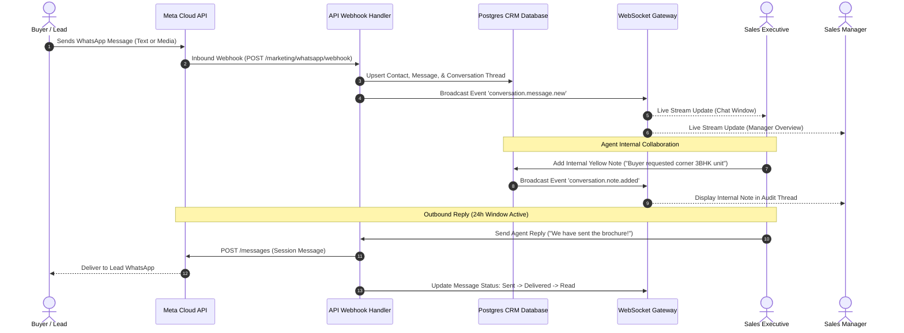

## Unified Multi-Agent Team Inbox

The BrokerOS WhatsApp Team Inbox provides a centralized communication hub for your entire sales and closing department. Rather than client conversations remaining locked inside individual sales agents' personal phones, every WhatsApp interaction is tied to the central CRM lead record and accessible through a real-time web workspace.

Key organizational benefits include:

- **Zero Lead Leakage**: Inquiries are logged centrally, ensuring full visibility even during agent handoffs or absences.
- **Role-Based Visibility**: Sales executives manage their assigned chats, while sales managers supervise all department threads with SLA tracking.
- **Single Business Number**: All outbound and inbound messages route through your verified WhatsApp Business Account (WABA) number.

---

## Real-Time Messaging Architecture

---

## Workspace Layout and Controls

The Team Inbox interface is divided into three functional columns:

### Conversation Directory (Left Column)

- **Folder Tabs**: Filter conversations by **Mine** (assigned to logged-in user), **Unassigned** (pending routing), and **All Conversations** (manager view).
- **Status & Label Filters**: Sort by pipeline stage, unread status, active 24-hour window, or custom tags (such as `Hot Investor`, `NRI`, `High Budget`).
- **SLA Badges**: Visual indicators highlighting conversations pending a response for more than 5 minutes.

### Conversation Stream (Center Column)

- **Unified Timeline**: Displays incoming buyer messages, outgoing agent replies, automated chatbot responses, and internal team notes in chronological order.
- **Internal Team Notes**: Yellow-tinted notes visible exclusively to internal staff. Used for sharing buyer background, credit verification details, or handover instructions.
- **24-Hour Session Timer**: A persistent indicator showing remaining time in the Meta customer service window. If expired, the input area transitions to template selection mode.
- **Quick Replies (`/` shortcuts)**: Pre-configured message snippets for instant answers (for example, `/directions`, `/brochure`, `/payment-terms`).

### Lead Context Drawer (Right Column)

- **CRM Profile Summary**: Immediate access to lead name, phone number, email, assigned project, and budget range.
- **Temperature & Score**: Live display of lead temperature (`HOT`, `WARM`, `COLD`) and AI qualification score.
- **Inline Actions**: One-click shortcuts to update lead status, schedule an on-site visit, or reassign the conversation to another closing specialist.

---

## The 24-Hour Customer Service Window

Meta enforces strict messaging guidelines to prevent customer spam:

| Window Status | Eligible Actions | Cost and Approval |
| :-- | :-- | :-- |
| **Active Session (Under 24 Hours)** | Sales agents can send arbitrary free-form text, voice notes, PDFs, location cards, and images. | Standard service conversation rate; no template pre-approval needed. |
| **Expired Session (Over 24 Hours)** | Input box is locked for free-form typing. Agents must select a pre-approved Meta template (Utility or Marketing) to reopen the conversation. | Standard business-initiated template rate; template must be Meta-approved. |

---

## Conversation Assignment and Routing

BrokerOS supports both automated and manual assignment policies:

- **Automatic Project Matching**: If an incoming phone number matches an existing lead in the CRM, the conversation is automatically assigned to that lead's existing sales executive.
- **Round-Robin Queue**: New inquiries from first-time prospects are distributed evenly among on-duty sales agents assigned to the active campaign project.
- **Manager Override**: Sales managers can reassign active threads at any time with an accompanying internal transition note.
