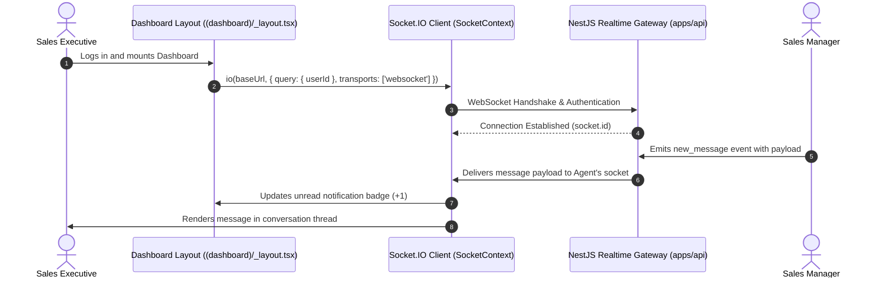

## Real-Time Messaging Architecture

The BrokerOS mobile app includes a built-in **internal team communications platform** powered by **Socket.IO**. Designed exclusively for internal brokerage staff, it enables sales executives, telecallers, and managers to communicate in real time without resorting to unmonitored personal messaging apps.

All communication is strictly confined to authenticated CRM users inside your brokerage organization.

---

## Connection Lifecycle & State Management

The mobile chat client establishes a persistent WebSocket connection through [`apps/mobile/lib/SocketContext.tsx`](file:///c:/Users/Sumama/Desktop/enterprise-crm-realtors/apps/mobile/lib/SocketContext.tsx):



---

## Technical Features

| Feature | Description |
| :-- | :-- |
| **Direct Messaging** | Encrypted peer-to-peer dialogues between any two internal colleagues. |
| **Project Channels** | Dedicated group channels organized around specific real estate projects. |
| **Lead Profile Cards** | Tapping "Share Lead" attaches an interactive card with lead temperature, budget, and contact info. |
| **Read Receipts** | Real-time indicators showing when colleagues have viewed your message. |
| **Unread Count Sync** | Badge counter in the top header updates instantly on incoming message events. |
| **Background Push Fallback** | If the app is minimized, Firebase FCM delivers an instant push notification alert. |

---

## Accessing the Chat

Employees can tap the **message bubble icon** in the top-right header from any dashboard screen:

```tsx
// Inside apps/mobile/app/(dashboard)/_layout.tsx
<Pressable
  onPress={() => {
    Haptics.impactAsync(Haptics.ImpactFeedbackStyle.Light);
    router.push('/(dashboard)/chat');
  }}
  className="w-9 h-9 rounded-xl bg-slate-50 items-center justify-center border border-slate-200/80 mr-2.5 active:scale-95"
>
  <MessageSquare size={18} color="#0f172a" />
</Pressable>
```

---

## Connectivity & Offline Behavior

<Note>
  Real-time chat requires active internet connectivity (Wi-Fi or cellular data). If an agent enters an area with no reception, messages cannot be transmitted or received until network connectivity is re-established. Unlike the auto-dialer and GPS site visit verification systems, chat does not queue outgoing messages in local SQLite storage.
</Note>

---

## Chat vs. Notification Center

| Dimension | Team Chat | Notifications Center |
| :-- | :-- | :-- |
| **Source** | Human colleagues and managers. | System events and automated CRM triggers. |
| **Interactivity** | Bidirectional dialogue with text and attachments. | One-way actionable alerts with deep links. |
| **Transport** | Bidirectional WebSocket (`Socket.IO`). | Hybrid (BullMQ worker -> FCM + Socket.IO). |
| **Header Access** | Message bubble icon (`chat/index.tsx`). | Bell icon with unread counter (`notifications.tsx`). |
