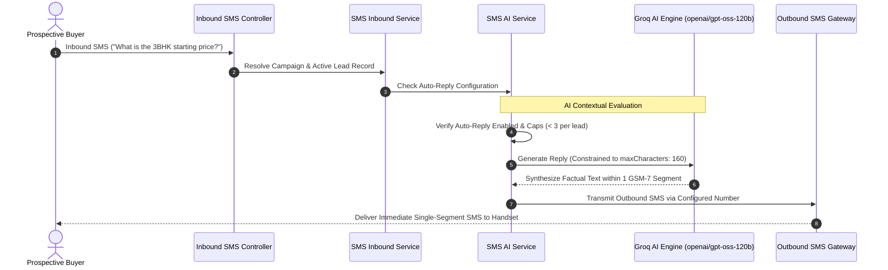

## SMS Intelligence and Operational Settings

The BrokerOS SMS Settings workspace (`/dashboard/marketing/sms/settings`) centralizes artificial intelligence configurations, diagnostic carrier testing tools, and CRM taxonomy used across text broadcasts, 2-way inboxes, and automation flows.

Key subsystems configured here include:

- **SMS AI Assistant & Autoreply**: Powers automated contextual replies and draft suggestions strictly optimized for 160-character segment constraints.
- **Inbound Webhook Diagnostics**: Live connection status, endpoint URLs, and simulated carrier payload execution.
- **SMS Tags and Quick Replies**: Pre-saved text shortcuts and CRM classification taxonomy.

---

## AI Assistant Architecture

---

## SMS AI Configuration

Configured through the **SMS AI Config Card** (`SmsAiConfigCard.tsx`):

### Model Selection and Provider

BrokerOS connects to ultra-low-latency inference engines for instant customer text replies:

- **Groq `openai/gpt-oss-120b` (Default)**: Sub-second inference latency, ensuring prospects receive helpful answers within seconds of texting your number.
- **OpenAI `gpt-4o-mini`**: Alternative model option.
- **Encrypted Key Storage**: API tokens are encrypted in the database using AES-256-GCM encryption.

### Strict 160-Character Single-Segment Constraint

Because multi-segment text messages double carrier billing costs, BrokerOS enforces a strict length limiter (`maxCharacters: 160`):

- The AI prompt instructs the language model to synthesize answers concisely without filler words.
- If an answer approaches the limit, the system appends a short-link (`https://brk.os/s/{token}`) directing the prospect to full project documentation.

### Autonomous Auto-Reply Safeguards

- **Activation Toggle (`autoReplyEnabled`)**: Enables autonomous outbound sending without requiring manual agent approval.
- **Loop Prevention Cap (`autoReplyMaxPerLead: 3`)**: Limits the maximum number of automated replies sent to a single lead on an SMS thread, preventing endless loops with automated carrier auto-responders.

---

## Inbound Carrier Webhook Diagnostics

The **SMS Webhook Diagnostics Card** (`SmsWebhookDiagnostics.tsx`) provides verified endpoint URLs for incoming SMS routing:

| Gateway Inbound Protocol | BrokerOS Dedicated Endpoint | Configuration Location |
| :-- | :-- | :-- |
| **Twilio Programmable SMS** | `/api/marketing/sms/inbound/twilio` | Twilio Console > Phone Numbers > Configure > A Message Comes In. |
| **AWS SNS / Pinpoint Topic** | `/api/marketing/sms/inbound/aws-sns` | AWS SNS Topic HTTPS subscription receiving inbound SMS notifications. |
| **Sinch SMS Inbound** | `/api/marketing/sms/inbound/sinch` | Sinch Dashboard > Numbers > Delivery & Inbound SMS Callbacks. |
| **Gupshup Enterprise** | `/api/marketing/sms/inbound/gupshup` | Gupshup Enterprise SMS Callback URL for DLT / Long-code 2-way traffic. |
| **Universal Inbound SMS API** | `/api/marketing/sms/inbound` | Standard JSON webhook for custom SMS aggregators, SMPP gateways, or private relays. |

### Real-Time Inbound Simulation Runner

Administrators can test incoming carrier routing without consuming cellular credits:

1. Select the simulated carrier (for example, Twilio or Gupshup).
2. Enter the test lead phone number, gateway phone number, and inquiry text.
3. Click **Simulate Inbound Delivery**. BrokerOS simulates the webhook payload, logs thread resolution, checks automation flow triggers, and displays the AI-generated SMS response in real time.

---

## Tags and Quick Replies Manager

The **Tags and Quick Replies Manager** (`SmsTagsAndQuickReplies.tsx`) allows sales teams to manage recurring shortcuts:

- **Quick Reply Macros**: Shortcuts like `/pricing`, `/directions`, or `/brochure` that agents can insert into message drafts with one click.
- **Lead Classification Tags**: Tags applied automatically or manually during text conversations (`#Price_Inquired`, `#Site_Visit_Requested`, `#High_Intent`).
