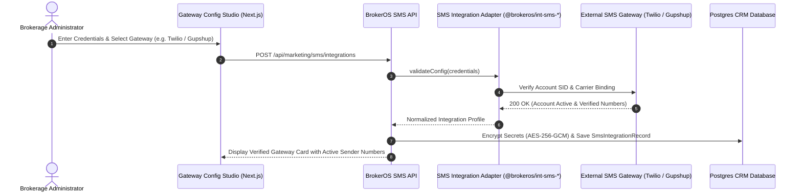

## Enterprise SMS Gateways and Carrier Adapters

BrokerOS isolates external telecommunication protocols inside self-contained TypeScript packages within `integrations/sms/`. Neither `apps/api` nor `apps/workers` makes direct HTTP calls to SMS aggregators; all transmission, signature validation, and error normalization route through these typed adapters.

Through the **SMS Gateway Configuration Studio** (`SmsProviderConfigCard.tsx`), administrators can connect and manage nine enterprise SMS services simultaneously.

---

## Gateway Connection Architecture

---

## The Nine Supported SMS Gateways

<CardGroup cols={2}>
  <Card title="Twilio Programmable SMS" icon="twilio">
    Global carrier aggregator. Connects via Account SID, Auth Token, and Messaging Service SID. Full 10DLC registration support and inbound webhooks.
  </Card>

  <Card title="Amazon SNS / Pinpoint" icon="aws">
    High-throughput cloud SMS relay. Connects via IAM Access Key ID, Secret Key, AWS Region, and Sender ID. Ideal for large-scale transactional broadcasts.
  </Card>

  <Card title="Gupshup Enterprise" icon="message">
    Primary telecom aggregator for Indian real estate operations. Connects via User ID, Password, and TRAI DLT Header IDs.
  </Card>

  <Card title="Sinch" icon="tower-broadcast">
    Tier-1 direct carrier connection network. Connects via Service Plan ID, API Token, and verified sender number.
  </Card>

  <Card title="Infobip" icon="signal">
    Enterprise cloud communications platform with direct mobile network operator (MNO) routes. Connects via API Key and Base URL.
  </Card>

  <Card title="Telnyx" icon="phone">
    Private global IP communications network with direct carrier peering. Connects via API Key and Messaging Profile ID.
  </Card>

  <Card title="Plivo" icon="mobile">
    Carrier platform with high delivery rates across North America. Connects via Auth ID and Auth Token.
  </Card>

  <Card title="Vonage (Nexmo)" icon="globe">
    Global telecommunication API. Connects via API Key, API Secret, and Brand Sender ID.
  </Card>

  <Card title="Bird (MessageBird)" icon="dove">
    Omnichannel messaging network. Connects via Access Key and registered Originator ID.
  </Card>
</CardGroup>

---

## Required Gateway Configuration Parameters

| Gateway Provider | Package Identifier | Required Credentials | Webhook Protocols Supported |
| :-- | :-- | :-- | :-- |
| **Twilio** | `@brokeros/int-sms-twilio` | `accountSid`, `authToken`, `fromPhone`, `messagingServiceSid` | Twilio Status Callback + Inbound SMS |
| **AWS SNS** | `@brokeros/int-sms-aws-sns` | `awsAccessKeyId`, `awsSecretKey`, `awsRegion`, `senderId` | Amazon SNS Topic HTTPS Subscription |
| **Gupshup** | `@brokeros/int-sms-gupshup` | `userId`, `password`, `dltHeader` | Gupshup Enterprise DLT Webhooks |
| **Sinch** | `@brokeros/int-sms-sinch` | `servicePlanId`, `apiToken`, `fromPhone` | Sinch Inbound & Delivery Callbacks |
| **Infobip** | `@brokeros/int-sms-infobip` | `apiKey`, `baseUrl`, `fromSender` | Infobip Delivery Reports Webhook |
| **Telnyx** | `@brokeros/int-sms-telnyx` | `apiKey`, `messagingProfileId`, `fromPhone` | Telnyx Webhook v2 |
| **Plivo** | `@brokeros/int-sms-plivo` | `authId`, `authToken`, `fromPhone` | Plivo Message Status Webhook |
| **Vonage** | `@brokeros/int-sms-vonage` | `apiKey`, `apiSecret`, `fromBrand` | Vonage Delivery Receipt Webhook |
| **Bird** | `@brokeros/int-sms-bird` | `accessKey`, `originator` | MessageBird Status Reporting |

---

## Regulatory Compliance Frameworks

BrokerOS simplifies navigation across global telecom regulations:

### United States: A2P 10DLC Regulations

- Requires registering your brokerage business brand and specific campaign use case (such as _Customer Care & Marketing_) with the Campaign Registry (TCR).
- Assigns Trust Scores that determine maximum Messages Per Second (MPS) allowed on 10-digit local numbers.

### India: TRAI DLT (Distributed Ledger Technology)

- Enforces strict registration across the regulatory blockchain before any commercial SMS is delivered.
- Every message must carry an approved **Principal Entity ID (PE ID)**, **Sender Header ID** (6 characters, for example, `SKYLNE`), and pre-approved **DLT Content Template ID**.
