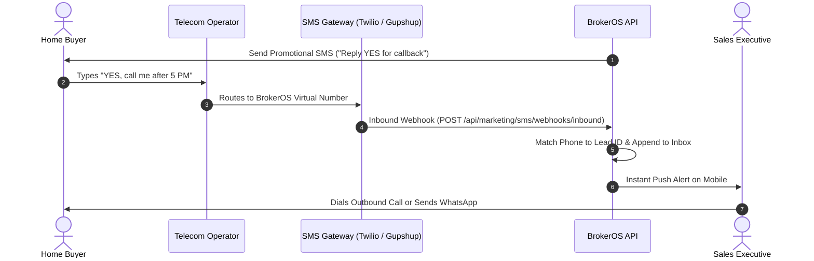

While traditional SMS is purely one-way broadcast, BrokerOS supports **Two-Way Conversational SMS** through dedicated Virtual Long Numbers (VLN) and shortcodes. Prospective buyers can reply directly to text messages to request callbacks, ask questions, or unsubscribe.

---

## Two-Way Messaging Architecture

Incoming text replies are matched to CRM lead records and delivered to representatives in real time:

---

## Virtual Long Numbers (VLN)

BrokerOS connects dedicated virtual phone numbers (for example, `+1 555-019-2831`):

- Hosted directly on cloud messaging gateways (Twilio, Gupshup, Sinch).
- Capable of receiving concurrent inbound text messages without busy signals.
- Inbound replies appear in the **SMS Team Inbox** instantly with desktop and mobile alerts.

---

## Keyword Auto-Responders

Marketing teams can configure automated responses for recognized incoming keywords:

| Incoming Keyword | Trigger Condition | Automated Action |
| :-- | :-- | :-- |
| **`YES`** / **`CALLBACK`** | Customer requests phone call. | Creates high-priority callback task for assigned agent. |
| **`BROCHURE`** | Customer requests collateral. | Auto-replies with short link to download PDF brochure. |
| **`STOP`** / **`DND`** | Statutory opt-out request. | Immediately blacklists phone number and confirms suppression. |

---

## Compliance Blacklisting and Opt-Outs

Under telecommunications regulations, customers maintain the legal right to opt out of commercial SMS at any time:

- When a customer replies _"STOP"_, BrokerOS immediately updates `lead.smsOptOut = true`.
- Future promotional SMS broadcasts automatically suppress this number during pre-flight checks.
- Protects the brokerage from carrier spam penalties and preserves sender reputation.
