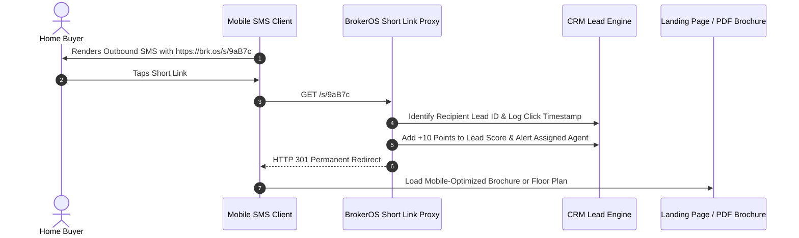

Standard marketing URLs consume 100+ characters, leaving virtually no room for promotional copy within a 160-character single-credit SMS. BrokerOS includes an integrated **Branded URL Shortener** that shrinks long links while capturing granular click analytics.

---

## Short Link Click Tracking Lifecycle

When a recipient taps a shortened link, BrokerOS logs their identity and redirects them instantly to the destination page:



---

## Preserving SMS Character Limits

By compressing URLs into a compact 22-character format, marketing copy remains safely within the **160-character single-credit threshold**:

```text
Template Example (148 Characters Total):
"Hi John, exclusive launch offer at Grand Horizon from $750k. Download brochure & master plan here: https://brk.os/s/9aB7c - BrokerOS Realty"
```

---

## Individual Lead Click Attribution

BrokerOS generates unique, personalized short-link hashes for each recipient in a campaign:

- When **John Doe** taps his link, the system records that **Lead ID #1042** interacted.
- The assigned sales executive receives an immediate push notification: _"John Doe just opened the Grand Horizon brochure link via SMS."_
- The lead's qualification score is automatically incremented by **+10 points**, prioritizing them on the telecaller callback queue.

---

## Real-Time Click Analytics

The Campaign Analytics dashboard visualizes link engagement across multiple dimensions:

| Metric | Target Benchmark | Description |
| :-- | :-- | :-- |
| **Click-Through Rate (CTR)** | 8% to 15% | Percentage of delivered recipients who clicked the link. |
| **Unique Clicks** | ~80% of total clicks | Deduplicated human visitors vs. repeat opens. |
| **Device Distribution** | ~92% Mobile | Breakdown between iOS, Android, and Desktop browsers. |
| **Peak Click Time** | 12:00 PM to 2:00 PM & 7:00 PM to 9:00 PM | Time-of-day engagement patterns for campaign scheduling. |
