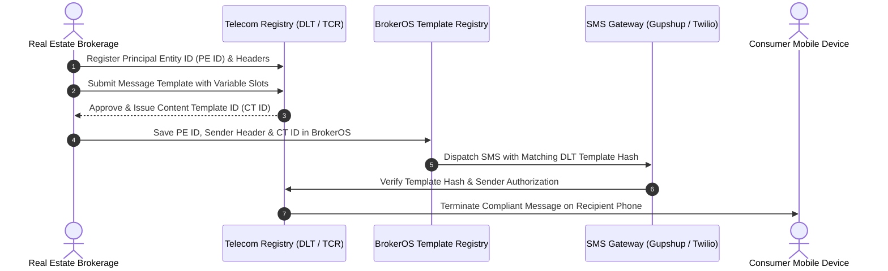

## Regulatory Compliance for Commercial SMS

To combat consumer spam, telecom regulatory bodies worldwide enforce strict pre-registration frameworks before commercial text messages can terminate on subscriber handsets:

- **India (TRAI)**: Mandates blockchain-based **Distributed Ledger Technology (DLT)** registration (Jio DLT, Airtel DLT, Vodafone Idea Vilpower).
- **United States (FCC / CTIA)**: Mandates **Application-to-Person 10-Digit Long Code (A2P 10DLC)** brand and campaign vetting via The Campaign Registry (TCR).

BrokerOS centralizes these regulatory identifiers in the **Template Registry** (`/dashboard/marketing/sms/templates`), guaranteeing that every outbound text carries approved header hashes and registered content tokens.

---

## Regulatory Verification Lifecycle

---

## DLT Identifiers in BrokerOS

To dispatch compliant SMS campaigns in regulated jurisdictions, configure your corporate DLT identifiers in the BrokerOS settings:

| Identifier | Format / Example | Description |
| :-- | :-- | :-- |
| **Principal Entity ID (PE ID)** | 19-digit number (`1101234567890123456`) | Corporate business identity registered on operator DLT portal. |
| **Header (Sender ID)** | 6-character alphabetic (`SKYLNE`) | The branded sender name displayed at the top of the customer inbox. |
| **Content Template ID (CT ID)** | 19-digit number (`1407161234567890123`) | Approved message body with locked text and variable slots (`{#var#}`). |

---

## Message Categories and Permitted Delivery Hours

Telecom regulations dictate message categories and permitted delivery windows:

| Category | Header Type | Delivery Window | Operational Use Case |
| :-- | :-- | :-- | :-- |
| **Service Implicit (Transactional)** | 6 Alphabetic (`SKYLNE`) | **24/7 (Anytime)** | Site visit appointment confirmations, payment receipts, OTPs. Bypasses DND registries. |
| **Promotional (Marketing)** | Numeric or Alpha-Numeric | **10:00 AM to 09:00 PM** | Discounts, festival offers, phase launch invites. Blocked on DND numbers. |

---

## Character Counts and Segment Credit Calculation

Telecom operators bill SMS messages based on encoding segments:

### Standard GSM 7-bit Encoding (English)

- **1 Segment (1 Credit)**: Up to **160 characters**.
- **2 Segments (2 Credits)**: 161 to **306 characters** (153 characters per segment due to concatenation headers).
- **3 Segments (3 Credits)**: 307 to **459 characters**.

### Unicode Encoding (Accented Characters, Regional Languages, Emojis)

- **1 Segment (1 Credit)**: Up to **70 characters**.
- **2 Segments (2 Credits)**: 71 to **134 characters** (67 characters per segment).

<Warning>
  Including even a single special character outside standard GSM-7 (such as certain curly quotes or emojis) forces the entire message into **Unicode mode**, instantly reducing your single-credit limit from 160 characters down to 70 characters.
</Warning>
