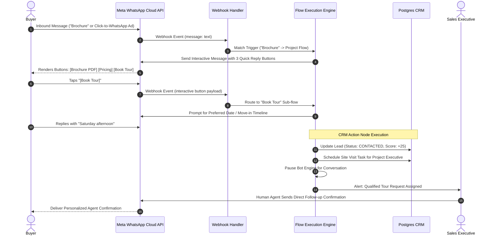

## Automated WhatsApp Conversation Workflows

Real estate buyers expect immediate responses to their inquiries, even during off-hours, weekends, or holidays. BrokerOS Chatbot Flows provide a visual, no-code automation builder that qualifies inbound leads, delivers digital brochures, answers pricing queries, and schedules property tours 24 hours a day.

Built on Meta Cloud API interactive messages (Quick Reply buttons and List Menus), chatbot flows eliminate typing friction for buyers while capturing structured data for your sales team.

---

## Flow Execution Architecture

---

## Flow Node Types

The visual drag-and-drop canvas provides six specialized node types designed specifically for real estate conversion:

### Message Node

Sends text descriptions, high-resolution architectural renderings, or downloadable project brochures:

- Supports dynamic merge variables such as `{{lead.firstName}}` and `{{project.name}}`.
- Attaches document headers directly from storage (such as PDF master plans and floor layouts).

### Interactive Quick Reply Node

Renders up to three clickable buttons beneath the message bubble:

- Example options: `[ Download Brochure ]`, `[ View Pricing ]`, `[ Schedule Tour ]`.
- Tapping a button fires an instantaneous webhook payload, advancing the conversation branch without requiring keyboard input.

### List Message Node

Presents a structured menu supporting up to 10 selectable items grouped by section:

- Useful for multi-project brokerages where buyers choose by location, property type (Penthouse, Townhouse, 2-Bedroom), or budget tier.

### Input Capture Node

Prompts the prospect for unstructured text or numerical input and persists the answer:

- Prompts for move-in timeline, investment horizon, or current residence city.
- Automatically maps answers to CRM lead fields (`budget`, `unitPreference`, `notes`).

### Conditional Branching Node

Evaluates lead properties or previous responses to route the conversation:

- Branches based on declared budget (for example, if budget exceeds \$1,000,000, route directly to Senior Partner).
- Branches based on whether the lead is a first-time buyer or institutional investor.

### CRM Action Node

Performs background updates within BrokerOS without interrupting the dialogue:

- Increments qualification score (for example, adding 20 points upon brochure download).
- Adjusts lead temperature to `HOT`.
- Creates calendar follow-up tasks and reassigns conversation ownership.

---

## Seamless Human Agent Handoff

Automation should never prevent high-intent buyers from speaking with a licensed sales agent:

- **Keyword Triggers**: If a buyer types words like "human", "speak to advisor", "call me", or "agent", the chatbot immediately yields control, notifies the assigned sales executive, and flags the conversation as urgent in the Team Inbox.
- **Agent Interruption Detection**: If a sales executive sends any message manually from the Team Inbox workspace, the bot engine automatically disengages for 24 hours to prevent conflicting automated responses.
- **Office Hours Routing**: Configure automated bot coverage exclusively during off-hours, allowing live agents to handle conversations during active business hours.
