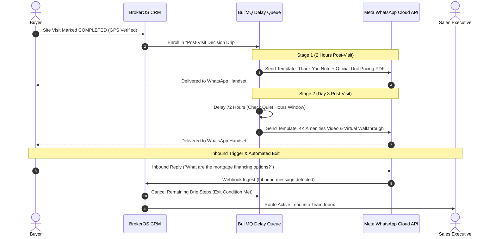

## Automated Multi-Stage Lead Nurturing

Real estate transactions have long consideration cycles. A prospective homebuyer or commercial investor who completes an on-site property tour on a weekend often requires several weeks to review mortgage eligibility, compare payment plans, and align family stakeholders.

BrokerOS WhatsApp Drip Automations keep your brokerage and developments top-of-mind through structured, contextual WhatsApp messages dispatched over predetermined intervals.

---

## Drip Sequence Execution Flow

---

## Event Triggers and Blueprint Templates

Drip sequences enroll prospects automatically upon trigger firing in the CRM core:

| Event Trigger | Qualifying Condition | Recommended Blueprint Sequence |
| :-- | :-- | :-- |
| `LEAD_INGESTED` | New lead captured from digital ad campaign or portal. | **Immediate Welcome Drip**: Instant brochure delivery, day 2 amenities highlights, day 4 invitation to book a private tour. |
| `SITE_VISIT_COMPLETED` | Site visit marked finished and GPS-verified by on-site sales team. | **Decision Accelerator Drip**: 2 hours post-visit cost sheet PDF, day 3 virtual tour link, day 6 exclusive payment plan incentives. |
| `HOLD_PLACED` | Temporary unit hold initiated by sales consultant. | **Hold Expiration Warning Drip**: Hour 6 token reminder, hour 20 final countdown before unit returns to public inventory. |
| `INACTIVE_30_DAYS` | Cold lead with zero logged touchpoints for over 30 days. | **Re-Engagement Drip**: Quarterly project construction milestone update and new tower phase announcement. |

---

## Quiet Hours and Timezone Safeguards

To maintain brand reputation and prevent customer complaints, BrokerOS strictly enforces delivery scheduling windows:

- **Quiet Hours Restriction**: Outbound messages are suppressed between **08:00 PM and 09:00 AM** (lead local timezone).
- **Graceful Rollover**: If a scheduled delay timer (for example, a 48-hour delay) expires at 11:30 PM on a Tuesday, the worker queue suspends execution and dispatches the payload at **09:30 AM on Wednesday morning**.
- **National Holiday Suppression**: Optional suppression rules hold marketing broadcasts during designated public holidays.

---

## Automated Exit and Disenrollment Conditions

Nurturing sequences must disengage immediately once a lead demonstrates active intent or requests opt-out:

- **Inbound Customer Reply**: If a prospect replies to any drip message, the sequence immediately terminates. The conversation is flagged as active and routed directly to the assigned sales executive in the Team Inbox.
- **Booking or Negotiation Initiated**: If a sales consultant enters formal price negotiations or creates a unit booking, all automated marketing drips for that lead cancel across all channels.
- **Explicit Opt-Out (`STOP` / `UNSUBSCRIBE`)**: When a lead replies with recognized opt-out keywords, the system updates the global suppression blacklist and logs consent revocation.
