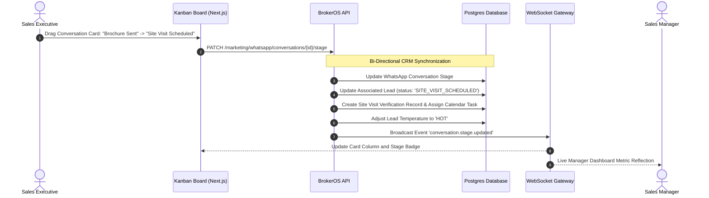

## Visual Deal Progression for WhatsApp

While the Team Inbox optimizes for rapid chronological conversation handling, the **Pipelines** workspace structures ongoing WhatsApp relationships into a visual Kanban board. This gives sales managers and team leads bird's-eye oversight of sales velocity, bottlenecked negotiations, and deal value directly tied to messaging threads.

Key benefits include:

- **Visual Deal Stage Tracking**: Move prospect conversations across qualification, appointment, and negotiation phases.
- **Bi-Directional CRM Sync**: Dragging cards automatically synchronizes lead status, task creation, and temperature scoring in the core CRM database.
- **Response SLA Monitoring**: Real-time visual timers alert supervisors when high-intent inquiries await agent responses.

---

## Pipeline Synchronization Architecture

---

## Standard Real Estate Pipeline Stages

BrokerOS provides a pre-configured pipeline tailored to property sales workflows, with customizable columns:

| Pipeline Stage | Operational Definition | Synchronized CRM Action |
| :-- | :-- | :-- |
| **New Incoming** | First inbound message received; awaiting initial response. | Creates conversation thread; triggers SLA timer. |
| **Contacted & Qualified** | Agent or chatbot has established budget, location, and move-in timeline. | Updates `Lead.status` to `CONTACTED`; sets temperature to `WARM`. |
| **Brochure / Plans Sent** | Floor plans, master layout, and pricing sheets shared with buyer. | Logs asset dispatch event; initiates automated follow-up timer. |
| **Site Visit Scheduled** | Prospective buyer has confirmed date and time for an on-site property tour. | Generates `SiteVisit` record; sets `Lead.status` to `SITE_VISIT_SCHEDULED`. |
| **In Negotiation** | Specific unit selected; commercial discounts or payment schedules under discussion. | Updates `Lead.status` to `NEGOTIATION`; sets temperature to `HOT`. |
| **Closed Won** | Reservation deposit received and unit hold/booking confirmed. | Launches unit booking workflow; converts lead to post-sales customer. |
| **Archived / Lost** | Buyer unresponsive or marked not interested. | Cancels automated drips; sets `Lead.status` to `LOST` with disposition reason. |

---

## Response SLA Timers and Supervisor Alerts

Every conversation card on the Kanban board features an active timer reflecting elapsed time since the prospect's most recent unanswered message:

- **Green Badge (Under 5 Minutes)**: Operating within standard response SLA.
- **Yellow Warning (5 to 15 Minutes)**: Approaching SLA threshold; card borders glow amber.
- **Red Alert (Over 15 Minutes)**: Breached response SLA. The card moves to the top of the column and dispatches an alert notification to the sales manager.

---

## Filter Views and Workload Balancing

Sales leaders can customize the board view using multi-attribute filters:

- **Project Filter**: Isolate leads interested in specific developments (for example, _Skyline Residences_ or _Grandview Towers_).
- **Executive Filter**: Inspect the individual pipeline for any assigned sales executive or closing consultant.
- **Investment Classification**: Filter cards by tags such as `#High_Net_Worth`, `#Investor`, `#First_Time_Buyer`, or `#Broker_Referred`.
