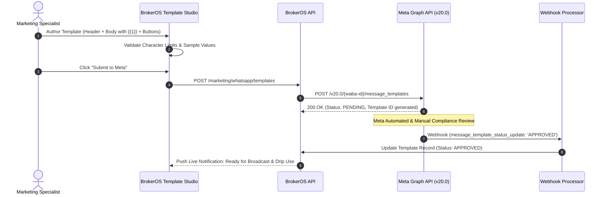

## Official Meta Message Templates

Under Meta WhatsApp Cloud API policies, businesses cannot initiate outbound WhatsApp conversations with free-form text. All outbound outreach, mass broadcasts, payment reminders, and automated drip sequences must utilize **Meta-Approved Message Templates**.

BrokerOS provides an integrated Template Studio where marketing teams can draft templates, preview live mobile renderings, test variable substitutions, and submit directly to Meta Graph API endpoints with automated status synchronization.

---

## Template Creation and Approval Lifecycle

---

## Template Categories and Approval SLAs

Meta categorizes templates into three functional tiers with distinct messaging rates and review timeframes:

| Template Category | Primary Real Estate Use Cases | Meta Approval SLA |
| :-- | :-- | :-- |
| **`MARKETING`** | New tower launch announcements, VIP preview invitations, project brochures, price reduction alerts. | 15 minutes to 24 hours |
| **`UTILITY`** | Site visit appointment confirmations, payment receipts, escrow status updates, loan milestone demand letters. | 1 to 5 minutes (Instant) |
| **`AUTHENTICATION`** | One-Time Password (OTP) verification codes for portal login, digital KYC, or reservation signature validation. | Instant automated review |

---

## Template Component Anatomy

Meta templates consist of four distinct modular components:

| Component | Format and Rules | Description |
| :-- | :-- | :-- |
| **Header (Optional)** | Text (60 chars max), Image (PNG/JPEG), Video (MP4), or Document (PDF brochure up to 100MB) | Appears prominently at the top of the message bubble. For real estate, PDF brochures and high-resolution rendering images are standard. |
| **Body (Mandatory)** | Plain text up to 1,024 characters with dynamic variables (`{{1}}`, `{{2}}`, `{{3}}`) | The primary message copy. Formatting supports bold (`*text*`), italics (`_text_`), and strikethrough. |
| **Footer (Optional)** | Plain text up to 60 characters | Muted gray disclaimer text, brokerage licensing numbers, or unsubscribe instructions. |
| **Buttons (Optional)** | Up to 3 Quick Reply buttons OR up to 2 Call-to-Action buttons | Interactive controls rendered beneath the footer for high engagement. |

---

## Interactive Button Configurations

Templates support rich interactive controls designed to drive immediate prospect response:

<CardGroup cols={2}>
  <Card title="Quick Reply Buttons" icon="reply">
    Pre-formatted reply pills: `[ View Floor Plans ]`, `[ Book Tour ]`, `[ Speak to Agent ]`. Tapping fires an immediate payload to activate chatbot flows or notify agents.
  </Card>

  <Card title="Call-To-Action (URL)" icon="arrow-up-right-from-square">
    Directs the prospect to an interactive 3D virtual tour, digital price sheet, or project microsite: `https://properties.yourbrokerage.com/skyline`.
  </Card>

  <Card title="Call-To-Action (Phone)" icon="phone">
    Tapping immediately prompts the user's mobile dialer to call your central brokerage closing desk.
  </Card>

  <Card title="Marketing Opt-Out Button" icon="ban">
    Meta strongly recommends a dedicated `[ Stop Promotions ]` Quick Reply button. Providing a direct opt-out dramatically reduces spam reports and protects your phone quality tier.
  </Card>
</CardGroup>

---

## Guidelines for Instant Meta Approval

Meta utilizes automated AI evaluation models to review submitted templates. Adhere to these guidelines to ensure immediate approval:

- **Include Realistic Variable Samples**: When submitting parameters like `{{1}}` and `{{2}}`, provide realistic sample values (for example, `{{1}} = "John"` and `{{2}} = "Skyline Residences"`). Submissions with missing or ambiguous sample values are automatically rejected.
- **Accurate Category Selection**: Do not attempt to classify promotional launch campaigns under the `UTILITY` category to secure lower rates; Meta will re-categorize or reject the template.
- **Professional, Non-Spammy Copy**: Avoid sensationalized capitalization or misleading promotional claims. Ensure clear grammar and professional real estate representation.
- **Valid HTTPS Links**: All destination URLs in Call-to-Action buttons must use valid HTTPS links matching your registered business domain.
