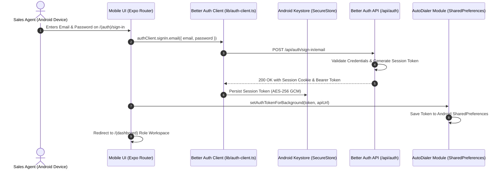

## Universal Authentication Architecture

The BrokerOS mobile application utilizes **Better Auth** with the official Expo integration plugin (`@better-auth/expo`). This is the identical authentication engine powering the Next.js web application, ensuring unified user identities, role verification, and server-side session invalidation across all clients.

Authentication tokens are never stored in unencrypted storage (`AsyncStorage`). Instead, session tokens are securely sealed inside **`expo-secure-store`**, which leverages Android Keystore hardware-backed encryption.

---

## Authentication Lifecycle



---

## Step-by-Step Login Flow

<Steps>
  <Step title="App Boot & Session Check">
    When the app boots, [`app/_layout.tsx`](file:///c:/Users/Sumama/Desktop/enterprise-crm-realtors/apps/mobile/app/_layout.tsx) invokes `authClient.useSession()`. If no valid token exists in `expo-secure-store`, the router redirects immediately to `/(auth)/sign-in`.
  </Step>
  <Step title="Credential Verification">
    The agent submits their work email and password. The client transmits the payload to `POST /api/auth/sign-in/email`.
  </Step>
  <Step title="Encrypted Token Storage">
    Upon successful authentication, the session token is written to `expo-secure-store`. On Android, this uses the Android Keystore system to protect keys inside dedicated hardware (TEE or Secure Element).
  </Step>
  <Step title="Native SharedPreferences Injection">
    To allow the native Kotlin background worker (`CallUploadWorker.kt`) to upload call recordings even after the JavaScript thread is paused or the app is closed, the dashboard shell calls:

    ```typescript
    setAuthTokenForBackground(String(session.session.token), baseUrl);
    ```

    This copies the active Bearer token into Android native `SharedPreferences` (`AutoDialerPrefs`), accessible by native background workers.
  </Step>
  <Step title="Dynamic Workspace Routing">
    The dashboard shell retrieves the user's `roleId`, queries the role definition from `GET /roles`, and renders the tailored bottom tab navigation matching that role.
  </Step>
</Steps>

---

## Client Configuration Code

The mobile auth client is configured in [`apps/mobile/lib/auth-client.ts`](file:///c:/Users/Sumama/Desktop/enterprise-crm-realtors/apps/mobile/lib/auth-client.ts):

```typescript
import { createAuthClient } from 'better-auth/react';
import { expoClient } from '@better-auth/expo';
import * as SecureStore from 'expo-secure-store';

export const authClient = createAuthClient({
  baseURL: process.env.EXPO_PUBLIC_API_URL,
  plugins: [
    expoClient({
      scheme: 'brokeros',
      storagePrefix: 'better-auth',
      storage: SecureStore, // Hardware-backed encrypted storage
    }),
  ],
});
```

---

## Session Persistence & Auto-Revalidation

Sessions persist seamlessly across device reboots and app restarts:

1. When the app returns from the background, `authClient.useSession()` reads the token from `expo-secure-store`.
2. A background HTTP ping revalidates the session against the backend.
3. If an administrator invalidates the user's session from the web dashboard (e.g., during employee offboarding), the mobile app clears local storage and forces an immediate return to the login screen.

---

## Sign-Out Flow & Resource Cleanup

When an employee taps the sign-out icon in the top header, BrokerOS executes an orderly cleanup sequence:

```typescript
// From apps/mobile/app/(dashboard)/_layout.tsx
const handleSignOut = async () => {
  Haptics.impactAsync(Haptics.ImpactFeedbackStyle.Medium);
  
  // 1. Invalidate session on server and clear Keystore
  await authClient.signOut();
  
  // 2. Clear native background tracking and telephony listeners
  await stopLocationTracking();
  stopListening();
  
  // 3. Route to login screen
  router.replace('/(auth)/sign-in');
};
```

This guarantees that:

- Background GPS tracking stops immediately and deletes the stored tracking user ID
- Native Android telephony broadcast listeners are unregistered
- The session token is purged from both `expo-secure-store` and native `SharedPreferences`

---

## Security Specifications

| Vector | Protection Mechanism |
| :-- | :-- |
| **Tokens at Rest** | Hardware-backed encryption via `expo-secure-store` (Android Keystore). |
| **Tokens in Transit** | HTTPS TLS 1.3 encryption on all API transport layers. |
| **Background Uploads** | Scoped `AutoDialerPrefs` accessible exclusively to the application package. |
| **Role Authorization** | Roles are validated strictly server-side from `session.user.role`. Body tampering is rejected. |
| **Session Invalidation** | Server-side revocation halts both mobile and web sessions immediately. |
