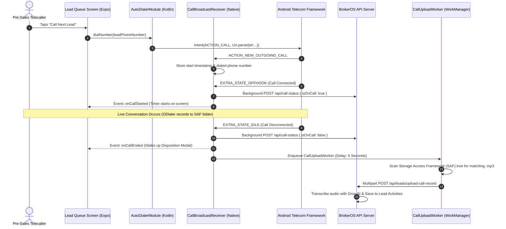

## What is the Auto-Dialer?

The BrokerOS Auto-Dialer is a **custom native Android module** written in Kotlin, embedded directly into the Expo mobile application ([`apps/mobile/modules/auto-dialer/`](file:///c:/Users/Sumama/Desktop/enterprise-crm-realtors/apps/mobile/modules/auto-dialer/)). It enables pre-sales telecallers to dial through daily lead queues consecutively without manually entering phone numbers or switching between multiple apps.

Every outgoing call is:

1. **Automatically initiated** using Android's native telephony manager and the agent's physical SIM card
2. **Monitored in real time** through native broadcast receivers that track call duration and connection status
3. **Reported to managers** via live status indicators (`User.isOnCall`), showing whether an agent is currently on a live call
4. **Recorded and uploaded** via Android Jetpack `WorkManager`, which runs in the background even if the app process is closed
5. **Transcribed with Groq AI** and attached to the lead's historical CRM timeline

---

## Native Telephony Engine Components

The auto-dialer consists of three core native Kotlin components working alongside the React Native JavaScript thread:

| Native Component | File Path | Role & Mechanics |
| :-- | :-- | :-- |
| **`AutoDialerModule.kt`** | `modules/auto-dialer/android/.../AutoDialerModule.kt` | Bridges JavaScript calls (`dialNumber`, `startListening`, `stopListening`) into the Android runtime. |
| **`CallBroadcastReceiver.kt`** | `modules/auto-dialer/android/.../CallBroadcastReceiver.kt` | Intercepts `ACTION_NEW_OUTGOING_CALL` and `ACTION_PHONE_STATE_CHANGED` intents to detect start and end times. |
| **`CallUploadWorker.kt`** | `modules/auto-dialer/android/.../CallUploadWorker.kt` | Android Jetpack `CoroutineWorker` that locates recordings in scoped storage and uploads them via HTTP. |

---

## Call Execution & Audio Ingest Pipeline

---

## Real-Time Manager Supervision (`useCallStatus`)

BrokerOS provides sales managers with live visibility into which agents are on a call. This is synchronized through the [`useCallStatus`](file:///c:/Users/Sumama/Desktop/enterprise-crm-realtors/apps/mobile/hooks/useCallStatus.ts) hook mounted at the root of the dashboard shell:

- When `onCallStarted` fires: The mobile app triggers `POST /api/call-status { isOnCall: true }`.
- When `onCallEnded` fires: The mobile app triggers `POST /api/call-status { isOnCall: false }`.
- Even if the React Native JavaScript thread is paused in the background, `CallBroadcastReceiver.kt` executes a fallback direct `HttpURLConnection` on a background thread using the auth token stored in `SharedPreferences`.

In the web dashboard, the manager's live employee cards display:

- **Green Status Indicator**: Agent is actively speaking on a connected call.
- **Yellow Status Indicator**: Agent is available and waiting for the next lead.
- **Gray Indicator**: Agent is offline or logged out.

---

## Background Audio Upload Architecture

To ensure audio recordings are uploaded reliably even if an agent force-closes the app or loses signal mid-shift, BrokerOS avoids relying on React Native background tasks. Instead, it utilizes native **Android Jetpack WorkManager**:

1. **Storage Access Framework (SAF)**: During setup, the agent grants BrokerOS persistent access to their call recording folder (`setODialerFolder`).
2. **Work Scheduling**: Upon `EXTRA_STATE_IDLE`, `CallBroadcastReceiver.kt` schedules a `OneTimeWorkRequestBuilder<CallUploadWorker>` with an initial delay of 5 seconds to ensure the recording app has finished writing the audio file.
3. **Timestamp Matching**: `CallUploadWorker.kt` reads the scoped document tree (`DocumentFile.fromTreeUri`), locates `.mp3` files modified during the call window, and validates length.
4. **Multipart Transmission**: The worker streams the file to `/api/leads/upload-call-record` using authentication credentials retrieved from `AutoDialerPrefs`.
5. **Automatic Exponential Backoff**: If the mobile device is offline, WorkManager pauses the upload job and automatically retries with exponential backoff once network connectivity returns.

---

## Required Android Telephony Permissions

The auto-dialer requires the following permissions declared in [`apps/mobile/app.json`](file:///c:/Users/Sumama/Desktop/enterprise-crm-realtors/apps/mobile/app.json):

| Android Permission | Technical Justification |
| :-- | :-- |
| `CALL_PHONE` | Allows the app to trigger outgoing telephone calls without manual dialer confirmation. |
| `READ_PHONE_STATE` | Detects telephony state transitions (RINGING, OFFHOOK, IDLE). |
| `READ_CALL_LOG` | Verifies call connection duration and confirms actual talk time. |
| `PROCESS_OUTGOING_CALLS` | Intercepts outgoing call intent to capture dialed phone numbers accurately. |
| `FOREGROUND_SERVICE` | Maintains audio synchronization and status reporting during active calls. |
| `RECORD_AUDIO` | Required by companion recording services and audio validation. |
