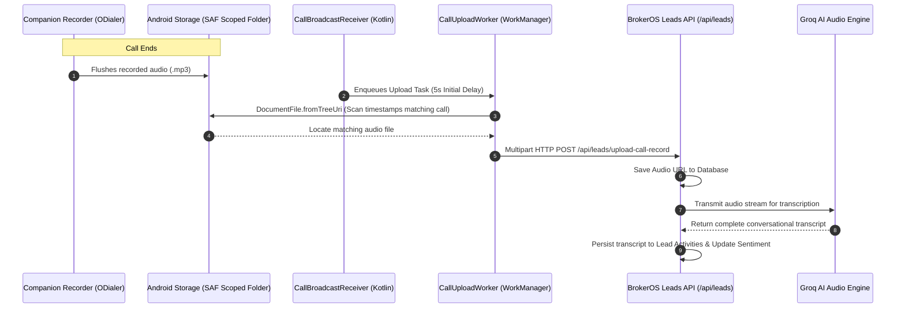

## Overview

Every conversation conducted through the mobile auto-dialer is captured, uploaded, and transcribed without requiring telecallers to manually operate voice recording tools.

The recording and transcription pipeline operates seamlessly:

1. Calls are recorded to local Android device storage by an approved companion recording app (such as ODialer)
2. The BrokerOS native Android module detects the newly written `.mp3` file
3. Android Jetpack `WorkManager` uploads the audio file in the background (even if the app is closed)
4. BrokerOS stores the audio in cloud storage (Vercel Blob)
5. Groq AI generates an automated conversational transcript and links it to the lead timeline

---

## Recording Ingest & Upload Architecture



---

## One-Time ODialer & SAF Folder Setup

Because Android modern scoped storage restricts cross-app file access, BrokerOS utilizes Android's **Storage Access Framework (SAF)** to gain persistent permission to read the call recording directory:

<Steps>
  <Step title="Install Companion Recording App">
    Install an approved call recording dialer (such as ODialer) on the Android device.
  </Step>
  <Step title="Configure Recording Permissions">
    Open the recording application, grant necessary telephony permissions, and configure auto-recording for all calls in `.mp3` format.
  </Step>
  <Step title="Grant Scoped Folder Access in BrokerOS">
    In the BrokerOS mobile app:

    1. Navigate to **Pre-Sales Settings -> Recording Configuration**.
    2. Tap **Select Recording Folder**.
    3. The Android system file picker displays available directories. Navigate to the ODialer audio directory (e.g., `Internal Storage/ODialer` or `Internal Storage/Recordings/Call`).
    4. Tap **Use this folder** and confirm **Allow**.
    5. The app executes `setODialerFolder(folderUriString)`, storing the persistent directory URI in Android `SharedPreferences`.
  </Step>
  <Step title="Execute Validation Call">
    Make a test call to verify that the file appears in the CRM timeline within 30 seconds of disconnection.
  </Step>
</Steps>

---

## WorkManager Background Execution

The audio upload pipeline is guaranteed by Android's **Jetpack WorkManager** (`CallUploadWorker.kt`), offering several architectural advantages:

- **Independent of React Native**: The worker runs natively in Kotlin. Even if the user terminates the BrokerOS app or turns off their screen, the Android OS completes the upload.
- **Grace Period Window**: A 5-second initial delay ensures the recording dialer has finished writing and closing the audio stream on disk before upload begins.
- **Timestamp Filter**: The worker scans the scoped folder and matches audio files modified within the call window (between `startTime` and `endTime + 15000` ms).
- **Network Resilience**: If the agent is in a dead zone or has no mobile data, WorkManager retains the job and executes it automatically once connectivity is restored.

---

## AI Transcription & Manager Timeline

Once uploaded, the audio file is processed by Groq AI. The resulting transcript is published directly to the lead's activity timeline:

```text
Telephone Call: 5 min 32 sec [Play Audio Recording]

Transcript:
Agent: "Hello, I am calling from Skyline Realty regarding your inquiry for the 3BHK luxury units."
Lead:  "Yes, I wanted to understand if east-facing units are still available on higher floors."
Agent: "Yes, Tower B has units available on the 14th and 16th floors. Would you like to visit tomorrow at 3 PM?"
Lead:  "Tomorrow 3 PM works for me. Please send the location pin."
```

Transcripts are indexed for CRM search, allowing sales directors to search keywords like _budget_, _discount_, or _possession date_ across all call histories.

---

## Storage & Data Governance

| Governance Dimension | Implementation |
| :-- | :-- |
| **Object Storage** | Centralized Vercel Blob cloud storage managed via `@brokeros/storage`. |
| **Data Retention** | Configurable organization policy (standard default: 90 days). |
| **Access Control** | Restricted to assigned managers, team leaders, and compliance admins. |
| **Scrubbing & Purging** | Compliant with enterprise privacy policies upon formal customer request. |
